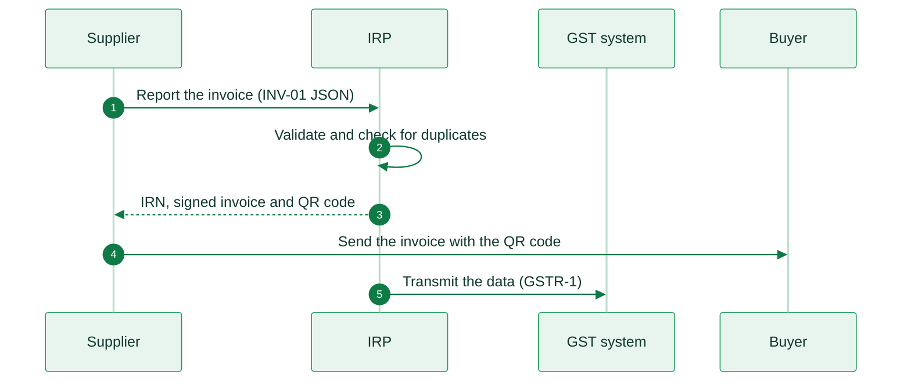

import IndiaResources from '/snippets/tables/india-resources.mdx';
import ComplianceFAQ from '/snippets/faqs/in/composers/page-compliance.mdx';

<Card title="India's e-invoicing regulation timeline" size="20" icon="timeline" href="/timelines/india" horizontal>
  View current and upcoming regulation →
</Card>

<IndiaResources />

<Note>
Invopop does not connect to the Indian Invoice Registration Portals today. The information below is for reference. For inquiries, contact us at [support@invopop.com](mailto:support@invopop.com).
</Note>

## Executive summary

India uses a clearance model for business invoices under the Goods and Services Tax (GST). A supplier in scope reports each invoice, credit note and debit note to an **Invoice Registration Portal (IRP)**. The IRP validates the data and returns an **Invoice Reference Number (IRN)**, a digital signature and a QR code. An invoice that a supplier in scope issues without an IRN is not a valid invoice.

The legal base is **rule 48(4) of the CGST Rules, 2017**. **Notification 13/2020-Central Tax**, as amended, sets who must comply:

* **Who**: registered persons whose aggregate turnover exceeds **Rs 5 crore** in any preceding financial year from 2017-18. The turnover counts all GST registrations (GSTINs) of the same PAN.
* **Since**: 1 October 2020 for the largest businesses. The threshold came down in steps to Rs 5 crore on **1 August 2023**.
* **What**: supplies to registered persons (B2B), supplies to government bodies that are registered for GST, and exports.
* **From 1 January 2027**: the buyer must also get an IRN for its own reverse-charge self-invoices. This covers purchases from unregistered suppliers and imports of services. GSTN has not yet announced the production date on the IRPs.
* **Not in scope**: invoices to consumers (B2C). Large suppliers print a payment QR code on B2C invoices instead.

The format is JSON in the **FORM GST INV-01** schema. Six IRPs are live. Reporting and IRN generation are free on all of them.

## Invoicing in India

The IRP does not deliver the invoice to the buyer. The supplier gets the IRN first, then sends the invoice to the buyer by any channel. The IRP passes the data to the GST system, which fills the supplier's GST return (GSTR-1).

<Steps>
  <Step title="Report the invoice">
    The supplier, or its software, sends the invoice data in the INV-01 JSON schema to one of the six IRPs.
  </Step>
  <Step title="Validate and check for duplicates">
    The IRP checks the data against the schema and the business rules. A central check stops the same document number from getting two IRNs.
  </Step>
  <Step title="IRN, signed invoice and QR code">
    The IRP returns the IRN, the signed invoice and a signed QR code.
  </Step>
  <Step title="Send the invoice">
    The supplier prints the QR code on the invoice and sends it to the buyer by any channel.
  </Step>
  <Step title="Transmit the data">
    The IRP sends the data to the GST system. The data fills the supplier's GSTR-1 return.
  </Step>
</Steps>

<AccordionGroup>
  <Accordion title="Business invoices (B2B, B2G and exports)">
    A supplier in scope gets an IRN for each invoice, credit note and debit note to a registered buyer. This includes government bodies that are registered only to deduct tax at source. Exports, supplies to Special Economic Zones (SEZ) and deemed exports are in scope too.

    |                     |                                                                        |
    | ------------------- | ---------------------------------------------------------------------- |
    | **Scope**           | B2B, B2G, exports, SEZ supplies, deemed exports                        |
    | **Format**          | JSON, FORM GST INV-01 schema version 1.1                               |
    | **Compliance**      | Clearance. The invoice is valid only with an IRN                       |
    | **Model**           | The IRP validates and signs. The supplier delivers                     |
    | **Effective date**  | 1 October 2020. Rs 5 crore threshold since **1 August 2023**           |
    | **Agency**          | CBIC (law) and GSTN (portals)                                          |
    | **Invopop support** | Not available                                                          |
  </Accordion>

  <Accordion title="Reverse-charge self-invoices (from 1 January 2027)">
    From 1 January 2027 the buyer must get an IRN for the self-invoice it issues in two cases. The first is a purchase from an unregistered supplier where the buyer pays the tax under reverse charge (supply type `RCMDOM`). The second is an import of services from a supplier outside India (supply type `RCMIMP`). For a purchase from an unregistered supplier, the buyer must issue the self-invoice within 30 days of receipt of the supply. The same Rs 5 crore turnover test applies to the buyer. The law applies from 1 January 2027, but gSTN has not yet announced the production date on the IRPs.

    |                     |                                                                        |
    | ------------------- | ---------------------------------------------------------------------- |
    | **Scope**           | Purchases under reverse charge from unregistered suppliers, imports of services |
    | **Format**          | JSON, FORM GST INV-01 schema version 1.2                               |
    | **Compliance**      | Clearance, by the buyer                                                |
    | **Effective date**  | **1 January 2027**                                                     |
    | **Agency**          | CBIC (law) and GSTN (portals)                                          |
    | **Invopop support** | Not available                                                          |
  </Accordion>

  <Accordion title="Consumer invoices (B2C)">
    Invoices to consumers get no IRN. A supplier with aggregate turnover above Rs 500 crore must print a **dynamic QR code** on each B2C invoice. The customer can scan it to pay. It holds the supplier GSTIN, the UPI ID or bank account and IFSC, the invoice number and date, the total and the GST amounts.

    |                     |                                                                        |
    | ------------------- | ---------------------------------------------------------------------- |
    | **Scope**           | B2C, suppliers above Rs 500 crore                                      |
    | **Compliance**      | Payment QR code on the invoice. No reporting to an IRP                 |
    | **Effective date**  | 1 December 2020                                                        |
    | **Invopop support** | Not available                                                          |
  </Accordion>

  <Accordion title="Who is out of scope">
    These suppliers do not issue e-invoices, whatever their turnover:

    * Insurers, banking companies and financial institutions, including NBFCs.
    * Goods transport agencies.
    * Suppliers of passenger transport services.
    * Suppliers of admission to films in multiplex screens.
    * Special Economic Zone units.
    * Government departments and local authorities.

    A supplier that is exempt but has turnover above the threshold puts a declaration on its tax invoices. It can also file a voluntary exemption declaration on the e-invoice portal.
  </Accordion>
</AccordionGroup>

## E-reporting

India has no separate e-reporting of e-invoices. The IRP sends each reported document to the GST system, and the data fills the supplier's GSTR-1 return. The supplier still files its GST returns.

For goods, a separate document called the **e-way bill** is needed when the value of a consignment exceeds Rs 50,000. All six IRPs can make the e-way bill from the IRN. From 1 January 2027 the e-way bill number is planned to grow from 12 to 14 digits.

## Regulation

<AccordionGroup>
  <Accordion title="Invoice format and content">
    The e-invoice is JSON in the **FORM GST INV-01** schema. The schema is part of the CGST Rules. Version 1.1 applies today. Version 1.2 applies from 1 January 2027.

    * Document types: `INV` (invoice), `CRN` (credit note) and `DBN` (debit note).
    * Supply types: `B2B`, `SEZWP`, `SEZWOP`, `EXPWP`, `EXPWOP` and `DEXP`. From 1 January 2027 also `SEZWPA`, `SEZWPNA`, `RCMDOM` and `RCMIMP`.
    * For exports, the buyer GSTIN is `URP` (unregistered person).
    * The IRN is a 64-character hash of the supplier GSTIN, the financial year, the document type and the document number. Since 1 June 2025 the IRP treats document numbers as case-insensitive.
    * Items carry an HSN code: 4 digits up to Rs 5 crore turnover, 6 digits above.
  </Accordion>

  <Accordion title="Deadlines, cancellation and corrections">
    * **30-day limit**: since 1 April 2025, a supplier with turnover of Rs 10 crore or more cannot report a document older than 30 days. This applies to invoices, credit notes and debit notes.
    * **Cancellation**: according to the IRPs, the supplier can cancel an IRN within 24 hours of generation. It cancels the whole document, never part of it. If an e-way bill exists for the IRN, the supplier cancels the e-way bill first. The same document number cannot get a new IRN after cancellation.
    * **Corrections**: according to the IRPs, after 24 hours the supplier issues a credit note or a debit note, which also needs an IRN.
  </Accordion>

  <Accordion title="Identifiers">
    * **GSTIN**: the 15-character GST registration number of each business in each state.
    * **PAN**: the Permanent Account Number. The e-invoice turnover test counts all GSTINs of one PAN.
    * **HSN**: the Harmonized System of Nomenclature code for each item.
  </Accordion>

  <Accordion title="Portals and providers">
    Six IRPs are live. Reporting and IRN generation are free on all of them.

    | IRP | Operator | Portal |
    |---|---|---|
    | IRP-1 | NIC | [einvoice1.gst.gov.in](https://einvoice1.gst.gov.in) |
    | IRP-2 | NIC | [einvoice2.gst.gov.in](https://einvoice2.gst.gov.in) |
    | IRP-3 | Cygnet | [einvoice3.gst.gov.in](https://einvoice3.gst.gov.in) |
    | IRP-4 | Clear | [einvoice4.gst.gov.in](https://einvoice4.gst.gov.in) |
    | IRP-5 | EY | [einvoice5.gst.gov.in](https://einvoice5.gst.gov.in) |
    | IRP-6 | IRIS | [einvoice6.gst.gov.in](https://einvoice6.gst.gov.in) |

    A taxpayer reports on the IRP web portal, through the IRP API, or through a **GST Suvidha Provider (GSP)** or an ERP. On the NIC and Cygnet IRPs, direct API access is only for taxpayers with turnover of Rs 100 crore or more (GSTN, November 2023). The IRP digitally signs the e-invoice. Logins use multi-factor authentication.
  </Accordion>

  <Accordion title="Archiving">
    A registered person keeps its books and records for **72 months** from the due date of the annual return for the year. Buyers and suppliers can download e-invoices of the past six months from the e-invoice portals.
  </Accordion>

  <Accordion title="Penalties">
    * An invoice that a supplier in scope issues without an IRN is not treated as an invoice.
    * Supply without an invoice, or with an incorrect invoice: a penalty of **Rs 10,000** or the tax evaded, whichever is higher.
    * Other breaches of the GST rules, such as a missing B2C QR code: a penalty of up to **Rs 25,000**.
  </Accordion>

  <Accordion title="More information">
    * [GSTN news and updates](https://www.gst.gov.in/newsandupdates): e-invoice and e-way bill advisories
    * [e-Invoice portal](https://einvoice.gst.gov.in): enablement status, IRN search and links to the six IRPs
    * [CBIC tax information portal](https://taxinformation.cbic.gov.in/): CGST Act, CGST Rules and notifications
    * [NIC e-invoice API sandbox](https://einv-apisandbox.nic.in/): API specification and sandbox
  </Accordion>
</AccordionGroup>

## FAQ

Compliance questions

<ComplianceFAQ />

More available in our [India FAQ](/faq/india) section

---

<Card title="Participate in our community"
  icon="forumbee"
  href="https://community.invopop.com"
  arrow="true"
  horizontal
>
  Ask and answer questions about India's regulation →
</Card>
