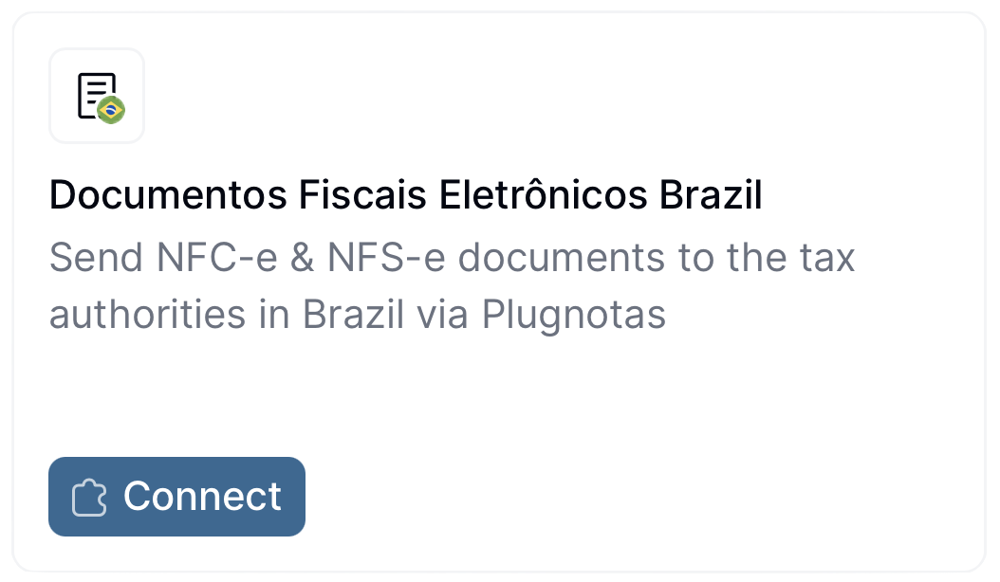
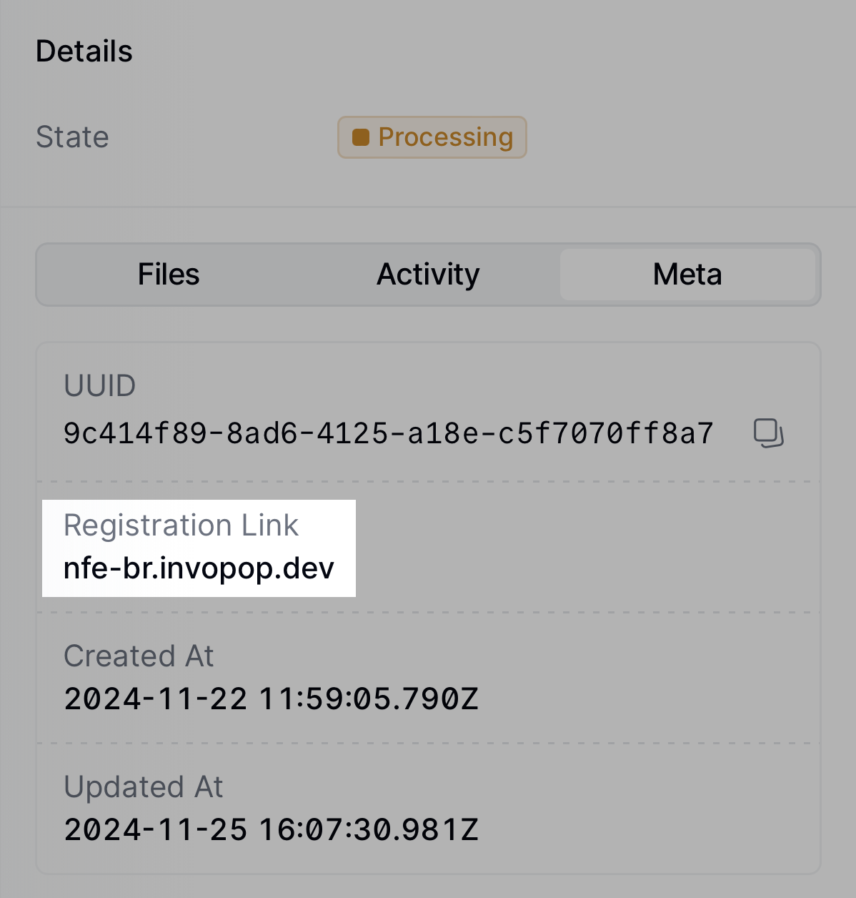
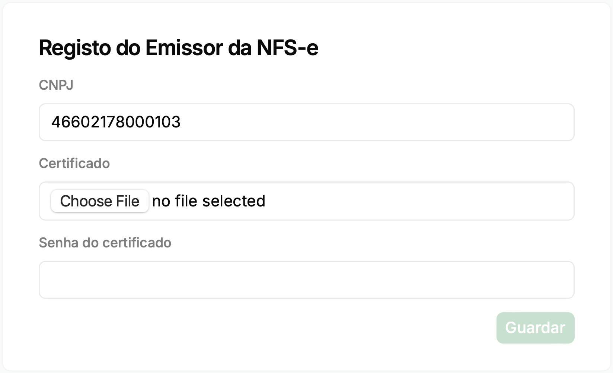
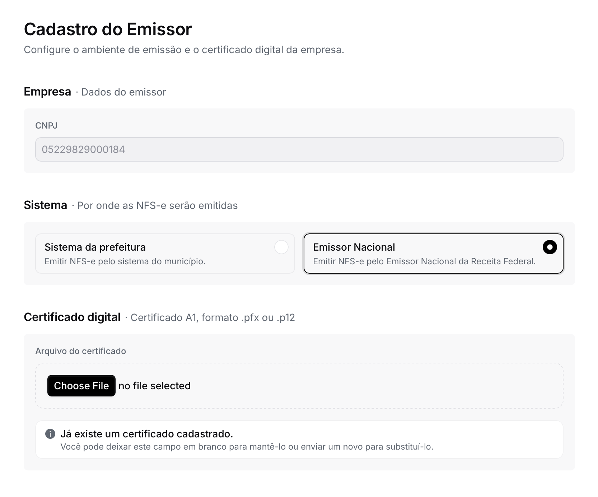

import PostRegistrationFlow from '/snippets/workflows/br/dfe-postregistration.mdx'
import RegisterSupplier from '/snippets/workflows/br/dfe-register-supplier.mdx'
import UnregisterSupplier from '/snippets/workflows/br/dfe-unregister-supplier.mdx'
import Supplier from '/snippets/parties/br/supplier.mdx'
import BrazilResources from '/snippets/tables/brazil-resources.mdx';
import FAQ from '/snippets/faqs/br/composers/guide-dfe-supplier.mdx';
import { WorkflowDiagram } from '/snippets/components/workflow.jsx';
import { brDfePostregistrationWorkflow } from '/snippets/workflows/br/dfe-postregistration.mdx';
import { brDfeRegisterSupplierWorkflow } from '/snippets/workflows/br/dfe-register-supplier.mdx';
import { brDfeUnregisterSupplierWorkflow } from '/snippets/workflows/br/dfe-unregister-supplier.mdx';

## Introduction

Before a supplier can issue electronic fiscal documents in Brazil — service invoices (NFS-e), product invoices (NF-e), or consumer invoices (NFC-e) — they must be registered with Invopop's local partner, PlugNotas, who authenticates the supplier with the corresponding tax authority.

In this guide you'll learn how to register a supplier using the [Documentos Fiscais Eletrônicos Brazil app](/apps/documentos-fiscais-electronicos-brazil), and how to unregister them when they should no longer issue documents from your workspace. Once a supplier is registered, continue with the companion guide: [Brazil: Issuing invoices](/guides/br-dfe).

| - | Sandbox | Live |
|---|---|---|
| **Supplier** | Registration required, but details don't need to be real | Real company details required |
| **Certificates** | Not required to be valid | Must be valid and real |
| **Environment** | Always simulation mode — responses are mocked | Homologation or production, chosen during registration |

## Prerequisites

To register a supplier in Brazil, you will need:

- Supplier details, including:
  - name,
  - CNPJ (_Cadastro Nacional da Pessoa Jurídica_),
  - address,
  - municipality code (IBGE),
  - municipal registration number (for NFS-e),
  - state registration number (for NF-e and NFC-e),
  - whether the supplier opts into the _Simples Nacional_ tax regime,
  - whether the supplier benefits from a fiscal incentive, and,
  - optionally, any special tax regime (MEI, estimated, coop…) the supplier is subject to.
- A certificate and password accepted by the municipality (for NFS-e) or the state (for NF-e and NFC-e) to send electronic fiscal documents in the name of the supplier.
- For NFS-e, knowing which system the supplier must issue through: the municipality's own system or the national _Emissor Nacional_. See [Choose the NFS-e system](#choose-the-nfs-e-system) below.

## Setup

There are three key processes to prepare:

- connect the **Documentos Fiscais Eletrônicos Brazil** app,
- create the supplier registration workflow, and,
- configure the supplier post-registration workflow.

<Info>
 These instructions apply to both the sandbox and live environments. Please note that the sandbox environment is simulated, and most responses are mocked. You'll still need to register suppliers in the sandbox, but the company details, certificates or passwords don't need to be valid or real.
</Info>

All of the following steps must be carried out from the [Invopop Console](https://console.invopop.com).

<Steps>

<Step title="Connect the Documentos Fiscais Eletrônicos Brazil app">
Enter the **Configuration** section, then tap **Apps**. Tap on the **Connect** button of the **Documentos Fiscais Eletrônicos Brazil** app.

<Frame>
  
</Frame>

</Step>

<Step title="Create the supplier registration workflow">

Follow one of the methods below and ensure to **Save** and **Publish** the workflow:

<Card iconType="duotone" title="DF-e register supplier" icon="code-branch" href="https://console.invopop.com/redirect/workflows/new?template=br-dfe-register-supplier" horizontal>
  Add to my workspace →
</Card>
<Tabs>
  <Tab title="Workflow">
    <WorkflowDiagram workflow={brDfeRegisterSupplierWorkflow} />
  </Tab>
  <Tab title="Code">
    Copy and paste into a new [Empty Party workflow](https://console.invopop.com/redirect/workflows/new?template=empty-party) code view.
    <RegisterSupplier />
  </Tab>
</Tabs>

</Step>

<Step title="Configure the supplier post-registration workflow">

Follow one of the methods below and ensure to **Save** and **Publish** the workflow:

<Card iconType="duotone" title="DF-e process supplier post-registration" icon="code-branch" href="https://console.invopop.com/redirect/workflows/new?template=br-dfe-postregistration" horizontal>
  Add to my workspace →
</Card>
<Tabs>
  <Tab title="Workflow">
    <WorkflowDiagram workflow={brDfePostregistrationWorkflow} />
  </Tab>
  <Tab title="Code">
    Copy and paste into a new [Empty Party workflow](https://console.invopop.com/redirect/workflows/new?template=empty-party) code view.
    <PostRegistrationFlow />
  </Tab>
</Tabs>

<Info>
  This workflow will automatically be executed once a supplier completes the registration process. You can customize it to suit your needs (_e.g._, adding a webhook, or an email notification after a supplier has been registered.)
</Info>

Now you need to go back to **Configuration** > **Apps**, tap the **Configure** button on the **Documentos Fiscais Eletrônicos Brazil** app, choose the "Post-registration workflow" we just created and **Save** the changes.

</Step>

</Steps>

## Register a supplier

All operations described in this section can be performed manually via the Invopop Console, or programmatically via the API. The process is essentially the same in both cases, so we'll demonstrate the manual method for this guide.

Find the **Parties** section of the sidebar and click **Suppliers**. Tap the **+ New Supplier** button to be presented with a new editor. Copy and paste the example provided below (for testing purposes only, in production you'll need the details of an actual company). The example includes all the fields required to register a supplier for both NF-e/NFC-e and NFS-e issuance.

<Supplier />

<Info>
  The `br-nfse-` identities and extensions configure service invoices (NFS-e), while the `br-nfe-` ones configure product and consumer invoices (NF-e/NFC-e) — omit the family the supplier won't issue.

  See the [`br-nfse-v1`](https://docs.gobl.org/addons/br-nfse-v1) and [`br-nfe-v4`](https://docs.gobl.org/addons/br-nfe-v4) addons for the possible values.
</Info>

Tap **Build**, ensure there are no errors, and click **Save**.

We should now see the document. Find and click the **Select Workflow** button. Select the **Register Supplier** workflow created during setup, and click **Run workflow**.

The execution should be successful, and the silo entry will now be in the `Processing` state. Tap the **Meta** tab to see the registration link:

<Frame>
  
</Frame>

<Info>
 You can access the registration link via the API by [fetching the silo
 entry](/api-ref/silo/entries/fetch-an-entry) and reading the `meta` row where
 the `key` is set to `registration-link`.
</Info>

Tap the registration link. A new browser window will open with a form to upload the supplier's credentials. Note that this form can be shared directly with the supplier, if necessary.

<Frame>
  
</Frame>

In live workspaces, the form also includes an environment selector ("Ambiente da prefeitura") with two options:

- **Homologação** (homologation): the tax authority's test environment. Documents are processed end to end but have no fiscal validity. Note that not all municipalities offer a homologation environment for NFS-e.
- **Produção** (production): the real environment. Documents issued here are legally valid.

The selected environment applies to every document type the supplier issues (NFS-e, NF-e, and NFC-e) and remains in effect until the supplier is registered again. See [Switch between environments](#switch-between-environments) below.

In sandbox workspaces, the selector is not shown: the sandbox always operates in simulation mode, and responses are mocked regardless of any environment.

### Choose the NFS-e system

The form also includes a **Sistema** section that decides where the supplier's service invoices (NFS-e) are sent:

<Frame>
  
</Frame>

- **Sistema da prefeitura** (municipal system): NFS-e are issued through the municipality's own system, with the municipality's service codes and rules.
- **Emissor Nacional** (national emitter): NFS-e are issued through the national NFS-e system run by the Receita Federal, using the national standard layout and the national service list.

The selection only affects NFS-e. Product and consumer invoices (NF-e and NFC-e) always go through the state's SEFAZ and are not affected.

Which option applies is defined by Brazilian regulation rather than by preference, so check the supplier's situation before registering:

| Supplier | System to select |
|---|---|
| _Microempreendedor Individual_ (MEI) | **Emissor Nacional**. Mandatory since 1 September 2023 (Resolução CGSN 169/2022). |
| ME or EPP in the _Simples Nacional_ regime | **Emissor Nacional**. Mandatory since 1 November 2026 (Resolução CGSN 191/2026), regardless of whether the municipality has joined the national system. |
| Any other supplier (_Lucro Presumido_, _Lucro Real_, etc.) | Depends on the municipality. Under Lei Complementar 214/2025, every municipality had to either move its taxpayers to the Emissor Nacional or keep its own system and share the invoices with the national environment from 1 January 2026. If the municipality moved to the Emissor Nacional, select it; if it kept its own system, select **Sistema da prefeitura**. |

When in doubt, confirm with the municipality's tax office or the supplier's accountant. The [Portal Nacional da NFS-e](https://www.gov.br/nfse/pt-br) publishes the list of municipalities that have joined the national system and whether each one uses the Emissor Nacional.

<Warning>
  Suppliers registered before this option was available are on the municipal system. Some of them now fall under the Emissor Nacional (for example, ME and EPP in the Simples Nacional since 1 November 2026, or suppliers whose municipality has since migrated) and must be switched, or their NFS-e will be rejected. Switching does not require uploading the certificate again: see [Re-register a supplier](#re-register-a-supplier) below.
</Warning>

The details from this form are sent securely to Invopop's local partner, PlugNotas, who will use them to authenticate the supplier in the corresponding tax authority.

The supplier must ensure that the certificate and password are valid and accepted by the municipality or state where they operate. For the Emissor Nacional, an A1 certificate (`.pfx` or `.p12`) is required to issue through the API.

Once the form is submitted, the supplier will be registered, and the post-registration workflow will be executed, changing the supplier's state to `Registered`.

From this point on, you can send invoices on behalf of the supplier. Head over to the [DF-e issuing invoices guide](/guides/br-dfe) to continue.

## Re-register a supplier

Running the registration process again over an already registered supplier lets you change their configuration without starting from scratch. The two settings you can change are the environment and the NFS-e system.

To re-register a supplier:

1. Run the **Register Supplier** workflow over the supplier's silo entry to obtain a new registration link.
2. Open the registration link. The form shows the supplier's current environment and NFS-e system pre-selected.
3. Select the new environment or system.
4. Leave the certificate field blank to keep the current certificate (or upload a new one), and submit the form.

Once the form is submitted, the supplier is reconfigured with the new settings and the post-registration workflow runs again.

### Switch between environments

In live workspaces, a supplier is registered in either homologation or production — never both at the same time.

A common scenario is registering a supplier in homologation first to test the integration end to end, and then re-registering them in production to start issuing real documents.

### Switch between NFS-e systems

Re-register the supplier and select the other option in the **Sistema** section whenever the system that applies to them changes. Typical cases:

- the supplier was registered before the system could be chosen (they are on the municipal system) and now falls under the Emissor Nacional,
- the supplier joins the Simples Nacional regime, which puts them on the Emissor Nacional,
- the supplier leaves the Simples Nacional regime in a municipality that kept its own system, which puts them back on the municipal system, or
- the supplier's municipality migrates its taxpayers to the Emissor Nacional.

Check the table in [Choose the NFS-e system](#choose-the-nfs-e-system) to confirm which system applies before switching: a change of tax regime only requires a switch if the applicable system actually changes.

The certificate does not need to be uploaded again. From the next NFS-e onwards, invoices are sent to the selected system, so make sure the service codes used on the supplier's invoices are the ones expected by that system: municipal codes for the municipal system, and the national service list for the Emissor Nacional.

<Warning>
  The environment selected in the most recent registration applies to **all** documents issued for that supplier from that point on, across every document type (NFS-e, NF-e, and NFC-e). After switching to homologation, no legally valid documents can be issued for the supplier until you register them back in production. Always verify which environment a supplier is in before issuing.
</Warning>

<Info>
  Sandbox workspaces are not affected: they always operate in simulation mode, and responses are mocked. To test against the tax authority's real homologation environment, register the supplier in a live workspace with the homologation environment selected.
</Info>

## Unregister a supplier

Unregistering a supplier revokes their invoice issuing privileges from your workspace. You might need to unregister an entity because the supplier is no longer your client or because of a change in their Tax ID. To do so, use the following workflow template:

  <Card title="DF-e unregister supplier" icon="code-branch" iconType="duotone" href="https://console.invopop.com/redirect/workflows/new?template=br-dfe-unregister-supplier" horizontal>
    Add to my workspace →
  </Card>
  <Tabs>
      <Tab title="Workflow">
        <WorkflowDiagram workflow={brDfeUnregisterSupplierWorkflow} />
      </Tab>
      <Tab title="Code">
        Copy and paste into a new [Empty Party workflow](https://console.invopop.com/redirect/workflows/new?template=empty-party) code view.

        <UnregisterSupplier />
      </Tab>
  </Tabs>

## FAQ

<FAQ />

More available in our [Brazil FAQ](/faq/brazil) section

---

<BrazilResources />

<Card title="Participate in our community"
  icon="forumbee"
  href="https://community.invopop.com"
  arrow="true"
  horizontal
>
  Ask and answer questions about invoicing in Brazil →
</Card>
