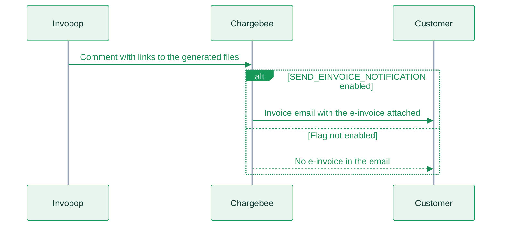

import ZUGFeRDExample from '/snippets/workflows/chargebee/cb-zugferd.mdx'
import XRechnungExample from '/snippets/workflows/chargebee/cb-xrechnung.mdx'
import FAQ from '/snippets/faqs/de/composers/guide-peppol-invoicing.mdx';
import { WorkflowDiagram } from '/snippets/components/workflow.jsx';
import { chargebeeCbZugferdWorkflow } from '/snippets/workflows/chargebee/cb-zugferd.mdx';
import { chargebeeCbXrechnungWorkflow } from '/snippets/workflows/chargebee/cb-xrechnung.mdx';

Germany supports two structured e-invoicing formats: **ZUGFeRD** and **XRechnung**. Both are valid and supported by Invopop, but they serve different purposes and have different requirements.

- **ZUGFeRD** is the most common choice for B2B invoicing. It has fewer validation constraints, which is why we always recommend embedding the XML inside a PDF — your customer receives a standard-looking PDF that also contains a machine-readable file. No per-customer setup is required.
- **XRechnung** is primarily used for B2G invoicing (invoicing public authorities). It has stricter validations and more required fields, but if your customers require it, Invopop fully supports it.

This guide assumes you have already connected the Chargebee app and completed the general setup — see the [Chargebee overview](/guides/chargebee) first if you haven't.

**Required apps:** [UN/CEFACT CII](/apps/uncefact-cii)

<iframe
  className="w-full aspect-video rounded-xl"
  src="https://www.youtube.com/embed/WJcWJqBiA-Q"
  title="Chargebee + Invopop | E-invoicing in Germany"
  frameBorder="0"
  allow="accelerometer; autoplay; clipboard-write; encrypted-media; gyroscope; picture-in-picture"
  allowFullScreen
  loading="lazy"
></iframe>

## Letting each customer choose a format

Each Chargebee customer can receive a plain PDF, a ZUGFeRD invoice or an XRechnung invoice. You choose the format per customer with the `cf_invopop_workflow` custom field. Each format has its own workflow.

<Steps>
  <Step title="Add one workflow per format">
    Add the workflows you need to your workspace: the [Chargebee PDF invoice](https://console.invopop.com/redirect/workflows/new?template=chargebee-cb-invoice) workflow, and the ZUGFeRD and XRechnung workflows from [Workflows](#workflows) below. Give each one a short, distinct name. You will use these names as dropdown values in Chargebee.
  </Step>
  <Step title="Set the default workflow">
    In the Chargebee app configuration, set **Workflow** to the format most of your customers need. ZUGFeRD suits most B2B customers.
  </Step>
  <Step title="Create the customer field in Chargebee">
    In Chargebee, go to **Settings** → **Configure Chargebee** → **Custom Fields** and create a dropdown field on customers with the API name `cf_invopop_workflow`. Use your workflow names as the dropdown values. Set the field at signup, by hand or with [bulk operations](https://www.chargebee.com/docs/2.0/bulk-operations.html). A customer with an empty field uses the default workflow.
  </Step>
  <Step title="Set a payment workflow">
    If **Import payments** is enabled, set a **Payment workflow** too. Otherwise payments follow the customer's workflow, and a `bill/invoice` workflow stops them with a `schema-mismatch` error. See [Importing payments](/guides/chargebee#importing-payments).
  </Step>
</Steps>

The app matches the field value against the names of your workflows that start with the **Import document from Chargebee** step. The match ignores case. A workflow UUID also works. A value that matches no workflow fails the import with `No workflow called "NAME" was found`.

<Warning>
  A plain PDF is not an e-invoice. Except for statutory exceptions such as small-amount invoices of €250 or less, invoices to businesses in Germany above €250 must be ZUGFeRD or XRechnung from 1 January 2027 if your prior-year turnover is above €800k, and from 1 January 2028 for every issuer. Use the PDF workflow for consumers and for buyers not established in Germany. See the [Germany FAQ](/faq/germany) for the transition rules and exceptions.
</Warning>

<Note>
  **Why not one workflow with an If/Else step:** the step's condition reads the GOBL invoice. The app copies only the keys listed in [Custom fields & metadata](/guides/chargebee#custom-fields-metadata) into it. A condition on your own Chargebee field, such as `cf_invoice_format`, never sees its value.
</Note>

## Using Chargebee's email delivery

The Chargebee app does not email your customers. It posts links to the generated files on the Chargebee invoice, and Chargebee attaches those files (the ZUGFeRD PDF, or the XRechnung XML) to its own invoice email only if your site is set up for it.



<Steps>
  <Step title="Invopop posts the files">
    When the workflow finishes, the **Update Chargebee** step posts a comment on the Chargebee invoice or credit note with links to the files the workflow generated. This happens with or without the flag, and needs a **Full Access API key**.
  </Step>
  <Step title="Chargebee emails the customer">
    If the flag is enabled and the settings below are in place, Chargebee attaches the files from that comment to its invoice email. Otherwise the files are only available through the links in the comment.
  </Step>
</Steps>

These must be in place in Chargebee:

| Setting | Where | Who sets it |
| ------- | ----- | ----------- |
| `SEND_EINVOICE_NOTIFICATION` feature flag | Chargebee back office. It is **not** visible in your Chargebee settings or in Invopop | Chargebee support or your Chargebee account manager, on request |
| `cf_invopop_include` set to `true` on the customer | Customer custom fields | You |
| Invoice and credit note email notifications | Chargebee email notification settings | You |

<Warning>
  The feature flag is enabled per Chargebee site. Ask Chargebee to enable it on your test site and again on your live site. Chargebee may also apply other conditions, such as the countries of your site and your customers, so confirm with Chargebee that it covers the invoices you send.
</Warning>

<Tip>
  A successful job means Invopop generated the files and posted them to Chargebee. It does not mean your customer received an email. If the files are in the invoice comments but not in the email, check the settings above with Chargebee.
</Tip>

## Workflows

<Tabs>
  <Tab title="ZUGFeRD (B2B)">
    <Card title="Chargebee ZUGFeRD" icon="code-branch" iconType="duotone" href="https://console.invopop.com/redirect/workflows/new?template=chargebee-cb-zugferd" horizontal>
      Add to my workspace →
    </Card>
    The ZUGFeRD workflow downloads the existing Chargebee PDF, generates the ZUGFeRD-compliant XML, and embeds the XML into the PDF to produce a single hybrid document. Chargebee then picks up the result and sends it to your customer. Beyond having a valid German supplier set up in Invopop, the template includes one additional step that addresses a specific requirement:

    **1. Bank details**

    When an invoice is paid by bank transfer, ZUGFeRD requires bank details to be present on the invoice. Chargebee typically includes this information in its PDF template, but it is not available via the API — so we cannot fetch it automatically. You will need to add your IBAN and BIC/SWIFT code directly into the **Add bank details** workflow step. Both fields are required.

    The step adds your bank details when the invoice has no payment method or is paid by bank transfer, such as [offline payments](https://www.chargebee.com/docs/payments/2.0/offline-checkout/offline_payments). For these invoices, Chargebee has no information about the destination account, so the bank details need to be included manually in the workflow.

    The step also runs only on invoices with a due date. Paid invoices and credit notes have none, so they get no bank details. A ZUGFeRD credit note without bank details can fail validation with `CII-SR-470`.

    <Warning>
      If you issue credit notes, edit the condition of the **Add bank details** step and remove its last line:

      ```
      && doc?.payment?.terms?.due_dates != nil
      ```
    </Warning>

    <Tabs>
      <Tab title="Workflow">
        <WorkflowDiagram workflow={chargebeeCbZugferdWorkflow} />
      </Tab>
      <Tab title="Code">
        <ZUGFeRDExample />
      </Tab>
    </Tabs>
  </Tab>
  <Tab title="XRechnung (B2G)">
    <Card title="Chargebee XRechnung" icon="code-branch" iconType="duotone" href="https://console.invopop.com/redirect/workflows/new?template=chargebee-cb-xrechnung" horizontal>
      Add to my workspace →
    </Card>
    XRechnung is used for invoicing German public authorities. It needs more data on your supplier than ZUGFeRD, and the template includes a few additional steps, each addressing a specific requirement:

    **1. Supplier contact and inbox**

    XRechnung requires a contact person and an electronic address for the seller (BR-DE-5 and PEPPOL-EN16931-R020). Chargebee doesn't hold them, so add them to your supplier in the [console](https://console.invopop.com), under **Contacts** → **Suppliers**:

    - **Person:** one contact person, with an email address and a telephone number. XRechnung also requires a seller email and telephone (BR-DE-6 and BR-DE-7). The person's are used when your Chargebee organization address has none.
    - **Inbox:** the email address where you receive e-invoices, or your Peppol ID.

    Without them, the first XRechnung job fails with `GOBL-DE-XRECHNUNG-BILL-INVOICE-04` (supplier people) and `GOBL-DE-XRECHNUNG-BILL-INVOICE-08` (supplier inboxes).

    **2. Bank details**

    XRechnung requires bank details to be present on the invoice. Chargebee typically includes this information in its PDF template, but it is not available via the API — so we cannot fetch it automatically. You will need to add your IBAN (and optionally your BIC/SWIFT code) directly into the **Add bank details** workflow step. The IBAN alone is sufficient.

    The step runs only on invoices with a due date. Paid invoices and credit notes have none, so they get no bank details and fail BR-DE-1 (`GOBL-DE-XRECHNUNG-BILL-INVOICE-17`).

    <Warning>
      Edit the condition of the **Add bank details** step and remove its last line:

      ```
      && doc?.payment?.terms?.due_dates != nil
      ```

      Do this in every XRechnung workflow. BR-DE-1 requires payment instructions on every invoice and credit note.
    </Warning>

    **3. Leitweg-ID as the buyer reference (ordering code)**

    Some German public sector customers require a **Leitweg-ID** to be present on the invoice as the buyer reference. This is typically entered as the PO number on the subscription in Chargebee. However, XRechnung expects this value in the buyer reference field, which Invopop maps to the ordering code — not the purchase order code. The **Map PO to ordering code** step handles this automatically, moving the value from the PO field into the correct place.

    If you prefer not to use the PO number for this, or if you need to set it independently, you can use the `cf_gobl_ordering` custom field instead, providing the value as JSON:

    ```json
    {"code": "991-12345678-06"}
    ```

    Credit notes don't take the PO number from the original invoice. Keep the Leitweg-ID as the PO number on the subscription, or in `cf_gobl_ordering` on the customer, so credit notes carry it too. A Leitweg-ID set only on the invoice leaves the credit note without a buyer reference, and it fails BR-DE-15.

    **4. Customer inbox (delivery routing)**

    Each public authority customer must have either a Peppol inbox or an email address configured so the invoice can be routed correctly. You can set these via custom fields on the customer in Chargebee:

    | Field | Metadata key | Custom field key | Example |
    | ----- | ------------ | ---------------- | ------- |
    | Leitweg-ID (Peppol inbox) | `gobl-customer-inbox-peppol` | `cf_gobl_customer_inbox_peppol` | `0204:991-12345678-06` |
    | E-invoice email | `gobl-customer-inbox-email` | `cf_gobl_customer_inbox_email` | `einvoice@behoerde.de` |
    | Leitweg-ID (ordering code) | `gobl-ordering` | `cf_gobl_ordering` | `{"code": "991-12345678-06"}` |

    <Tip>
      Use Chargebee's [bulk operations](https://www.chargebee.com/docs/2.0/bulk-operations.html) to back-populate the inbox and ordering code fields across all your public sector customers before going live.
    </Tip>

    <Note>
      The **Add bank details** step includes placeholder `bic` and `iban` fields that you must fill in with your own banking details. Note that Chargebee typically includes bank details directly in their PDF template, meaning this information is not available via the API for us to fetch automatically. As a result, bank details need to be added manually to the workflow step.
    </Note>

    <Note>
      The **Map PO to ordering code** step maps the first purchase order code from Chargebee into the `ordering.code` field that XRechnung requires as a buyer reference. This is particularly relevant when invoicing public entities (B2G), where a Leitweg-ID or PO number is mandatory. If the invoice has no purchase order code, the step is safely skipped. If you are not invoicing public entities and do not use ordering references, you can remove this step.
    </Note>
    <Tabs>
      <Tab title="Workflow">
        <WorkflowDiagram workflow={chargebeeCbXrechnungWorkflow} />
      </Tab>
      <Tab title="Code">
        <XRechnungExample />
      </Tab>
    </Tabs>
  </Tab>
</Tabs>

<Note>
  The metadata keys listed above follow the Chargebee metadata format (hyphens, no `cf_` prefix). If you prefer to use custom fields instead, replace hyphens with underscores and add the `cf_` prefix. See [Custom fields & metadata](/guides/chargebee#custom-fields-metadata) for details.
</Note>

## FAQ

<FAQ />

More available in our [Germany FAQ](/faq/germany) section

---

<Card title="Participate in our community"
  icon="forumbee"
  href="https://community.invopop.com"
  arrow="true"
  horizontal
>
  Ask and answer questions about your Chargebee integration →
</Card>
