import ConnectImportWorkflow from '/snippets/workflows/connect/import-supplier-invoices.mdx';
import { WorkflowDiagram } from '/snippets/components/workflow.jsx';
import { connectImportSupplierInvoicesWorkflow } from '/snippets/workflows/connect/import-supplier-invoices.mdx';

## Introduction

Invopop's [Connect app](/apps/connect) receives the invoices your suppliers and systems send you and imports them into your workspace as GOBL invoices. You create **endpoints**: an HTTP address other systems post files to, or an email address suppliers send invoices to. Each file an endpoint receives starts a job in a workflow you choose, and the workflow's **Import document** step does the import:

- **GOBL, UBL and CII** documents, and PDFs that carry one (Factur-X, ZUGFeRD), are converted as they are.
- **Other PDFs and images** are read with AI, which checks the amounts and notes anything it was unsure of.

Every import is graded, so your workflow can hold back the invoices a person should check and let the rest through.

This guide sets up a workflow, an endpoint for each channel, and the optional rules that guide the AI, then follows three invoices through.

## Set up

<Steps>
  <Step title="Enable the Connect app">
    In the Console, open the apps directory with the icon next to **Apps** in the sidebar, find **Connect** and click `Connect`. The app then appears in the sidebar under **Apps**.

    <Frame caption="The Connect app in the apps directory">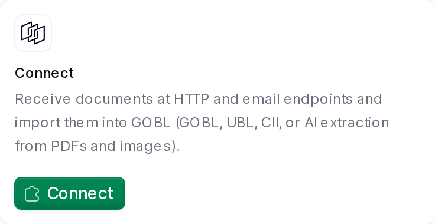</Frame>
  </Step>

  <Step title="Create the import workflow">
    Create an empty invoice workflow and paste the workflow below into its code view. Its **Import document** step imports each file, and the step's result decides what happens next:

    - `low`: something to check before the invoice is used. The AI was unsure of a field, the amounts didn't add up, or the invoice doesn't validate. The entry is set to `processing` so someone can look at it.
    - `high`: read with AI, with nothing to check. The entry is set to `received`.
    - `parsed`: a GOBL, UBL or CII document converted as it was. The entry is set to `received`.

    If the step fails (the file isn't an invoice, or it can't be read), the workflow's error branch sets the entry to `error`.

    <Tabs>
      <Tab title="Workflow">
        <WorkflowDiagram workflow={connectImportSupplierInvoicesWorkflow} />
      </Tab>
      <Tab title="Code">
        Copy and paste into a new [Empty Invoice workflow](https://console.invopop.com/redirect/workflows/new?template=empty-invoice) code view.
        <ConnectImportWorkflow />
      </Tab>
    </Tabs>

    <Frame caption="The workflow in the editor, with a branch for each result">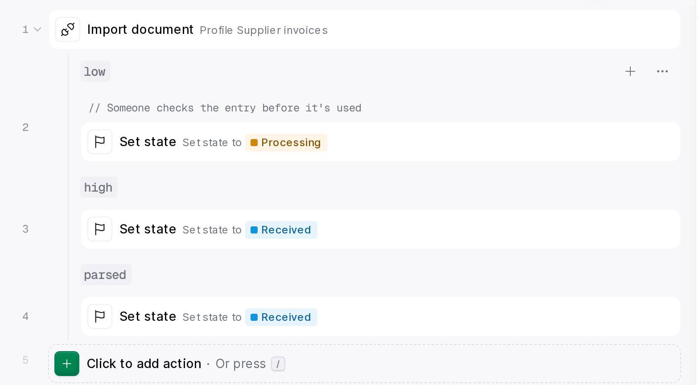</Frame>

    Replace the `Set state` steps with whatever your process needs: a webhook to your ERP for the `high` and `parsed` branches, for example, or an email to whoever checks the `low` ones. Each import costs 10 pops; imports that fail aren't charged.

    Publish the workflow. Endpoints can only use workflows that have an **Import document** step.
  </Step>

  <Step title="Choose a profile (optional)">
    Click the **Import document** step to see its settings. A **profile** gives the AI a set of rules about your documents (see [Rules and profiles](#rules-and-profiles) below). Rules only apply to PDFs and images read with AI. GOBL, UBL and CII documents are converted without AI.

    <Frame caption="The Import document step's settings">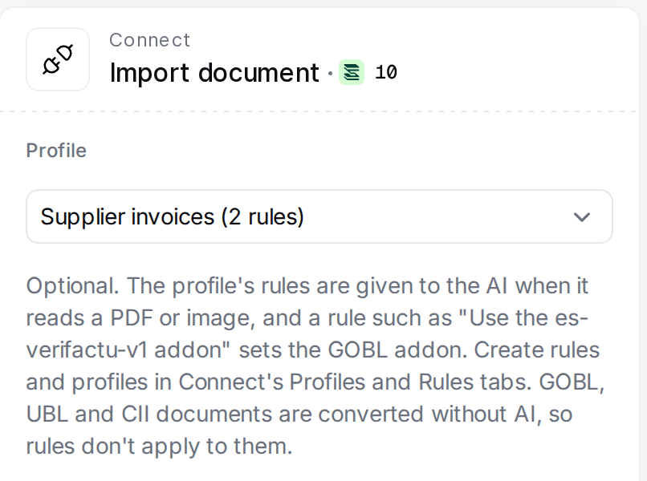</Frame>
  </Step>
</Steps>

## Receive documents

Open **Connect** from the sidebar and go to the **Endpoints** tab. Click `New`, choose the channel, and give the endpoint a **slug**, a short name unique in your workspace (lowercase letters, digits and hyphens), and the workflow to run.

<Tabs>
  <Tab title="HTTP">
    An HTTP endpoint has an address that other systems post files to, one file per request.

    - **Authentication**: how senders prove who they are: `Bearer token`, `Basic auth` or `HMAC signature` (a hex HMAC-SHA256 of the body in the `X-Signature` header). Use one for any endpoint that receives real documents. Secrets are stored encrypted and never shown again.
    - **Accepted content types**: optionally limit the endpoint to some types, such as PDF and XML. Leave it empty to accept any.

    <Frame caption="A new HTTP endpoint">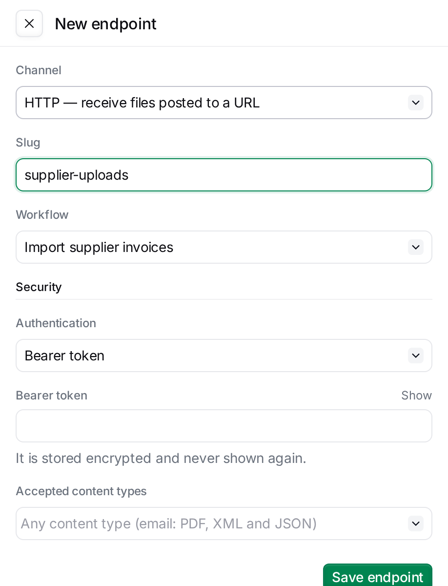</Frame>

    Save the endpoint, then open it to copy its address and a sample `curl` command. Send each file as the request body, with its content type:

    ```bash
    curl "https://connect.invopop.app/in/{workspace-id}/supplier-uploads" \
      -H "Authorization: Bearer $TOKEN" \
      -H "Content-Type: application/pdf" \
      --data-binary @invoice.pdf
    ```

    Connect answers `202` once the file is stored, with the message ID to follow it by:

    ```json
    {
      "message_id": "01a1e59f-d36e-7c0e-9a8e-6d1b48449f7b",
      "received_at": "2026-11-16T18:30:10Z"
    }
    ```

    A request that can't be taken gets `401` (authentication failed), `404` (no such endpoint), `413` (larger than 25 MB), `415` (content type not accepted) or `422` (malformed body).

    <Tip>
      Add an `Idempotency-Key` header to make a retried upload count once, and `?filename=` to name the stored file. If you can only send text, base64-encode the body and add `?encoding=base64`.
    </Tip>

    To follow a delivery, `GET` the same address with `/messages/{message_id}` at the end, using the same authentication. The answer has the message's state and the IDs of the jobs it started.
  </Tab>
  <Tab title="Email">
    An email endpoint takes the attachments of the emails it receives. Choose how emails reach it with the **Provider**:

    - **Invopop address**: an address on `invopop.email`, ready to use. It follows the slug as you type, and you can change it. It must not be taken by another workspace.
    - **Resend**: an address on your own domain, received by your Resend account. Give Connect a full access API key; it creates the webhook in your account when you save, and removes it when you delete the endpoint.
    - **SendGrid**: a hostname on your own domain, received by SendGrid's Inbound Parse. Connect creates the Inbound Parse setting when you save.
    - **IMAP**: a folder of an existing mailbox that Connect checks regularly, for when invoices already arrive at an address you can't change.

    <Frame caption="A new email endpoint with an Invopop address">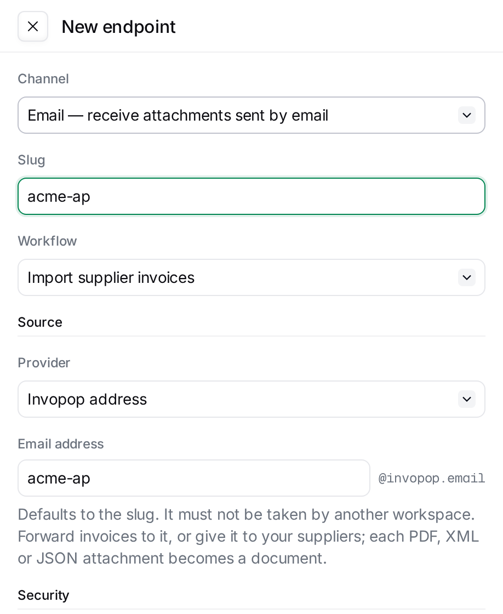</Frame>

    <AccordionGroup>
      <Accordion title="Resend settings">
        <Frame>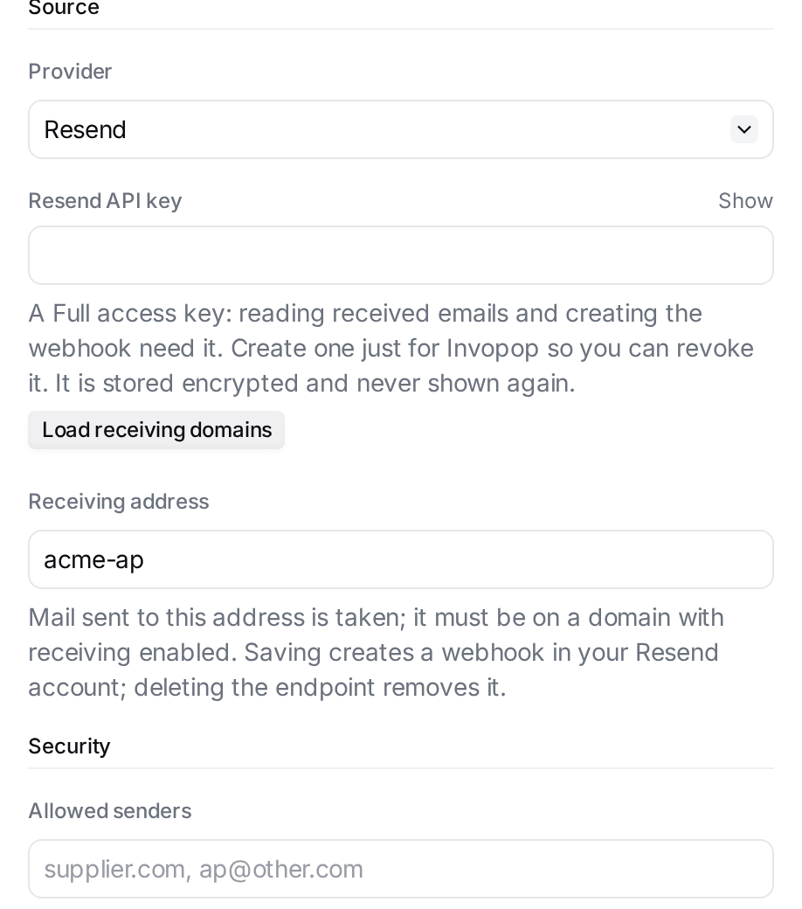</Frame>
      </Accordion>
      <Accordion title="SendGrid settings">
        Use a hostname only for this, with an MX record pointing at `mx.sendgrid.net` (priority 10).
        <Frame>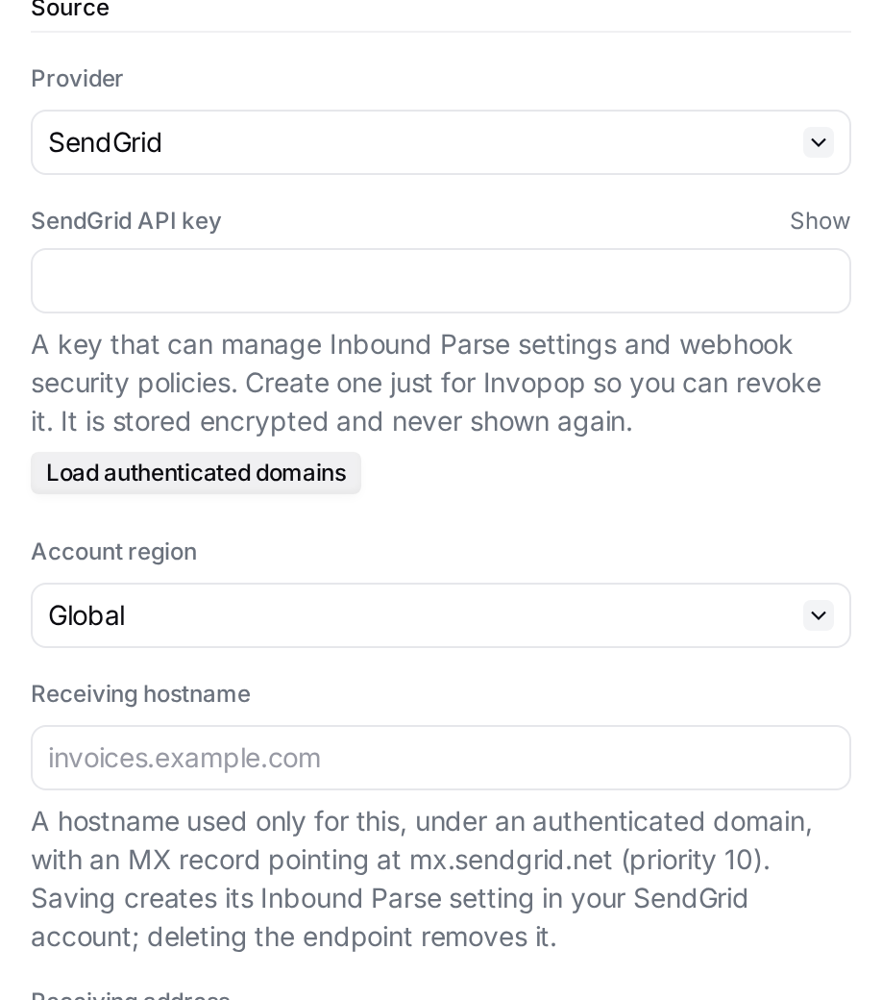</Frame>
      </Accordion>
      <Accordion title="IMAP settings">
        Use an app password if your provider offers them, and `Test connection` to check the settings and choose the folder.
        <Frame>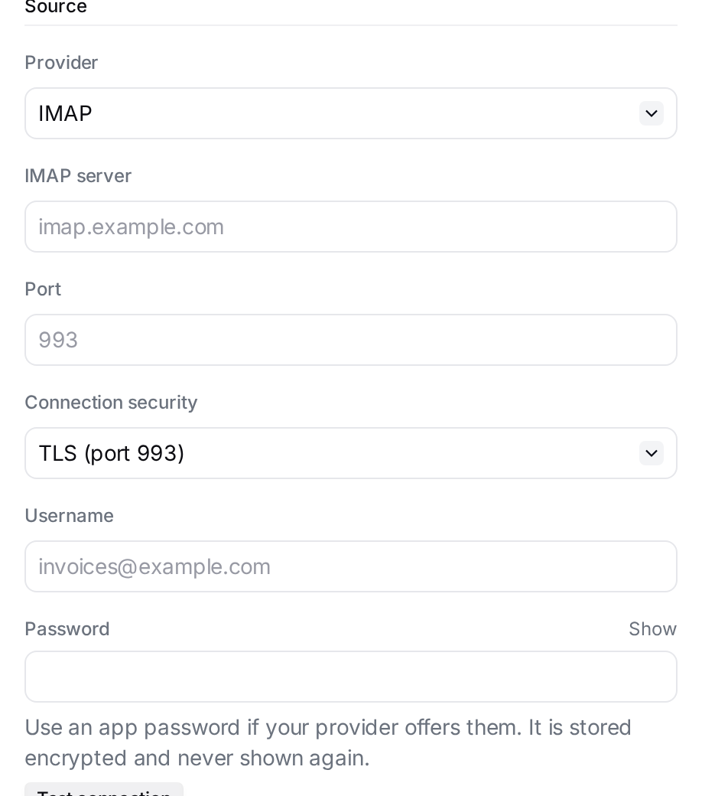</Frame>
      </Accordion>
    </AccordionGroup>

    Under **Security**, **Allowed senders** limits the endpoint to some addresses or domains (`supplier.com, ap@other.com`). A sender's address can be forged, so a message from an allowed sender is only taken when its domain is proven (DMARC, or a DKIM signature from the sender's domain). Leave it empty to take every message.

    How attachments become invoices:

    - Each PDF, XML, JSON or image attachment is an invoice with its own job. Images are only taken when attached and at least 30 KB, which leaves out logos and signatures.
    - An XML invoice and its PDF are one invoice: the XML is imported and the PDF attached to the same entry.
    - A PDF with several invoices is split, and each invoice's pages are imported on their own. Pages that aren't an invoice, such as terms or a delivery note, are attached to every invoice of the email.
  </Tab>
</Tabs>

The endpoints list shows each endpoint's channel, workflow and status. Use the `⋯` menu at the end of a row to disable, enable or delete an endpoint; a disabled endpoint refuses new documents.

<Frame caption="An email and an HTTP endpoint">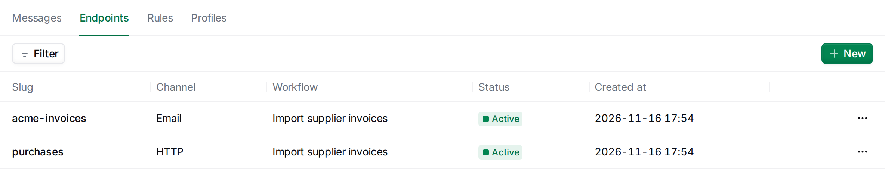</Frame>

## Follow what arrives

The **Messages** tab lists everything your endpoints received: an upload or an email, the endpoint, how many jobs it started and its status. A message from a sender who isn't allowed, or with nothing to import, is listed as skipped, with the reason.

<Frame caption="Messages received at the purchases endpoint">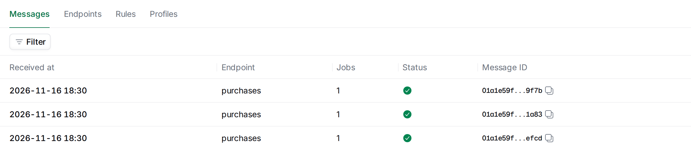</Frame>

Click a message to see the jobs it started and download the files it brought.

<Frame caption="A message's jobs and files">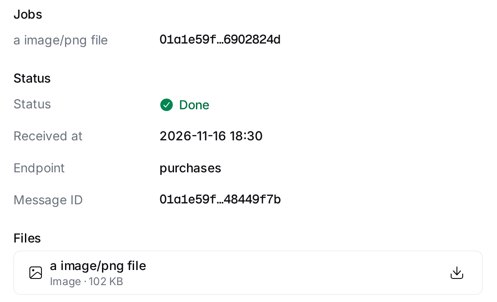</Frame>

## Review the results

Each job shows up in **Job history** with the 10 pops it cost.

<Frame caption="Three imports in the job history">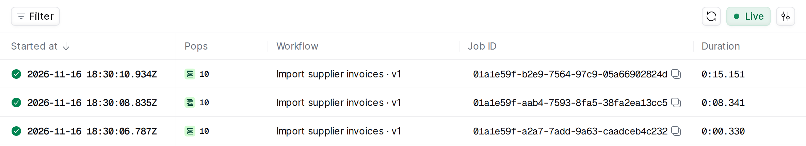</Frame>

Open a job and click the **Import document** step to read its result. The message says how the document was read, the invoice's number, supplier and total, and after **Check:** what needs a look, with the GOBL field and why. The scan below had its amounts partly hidden, so the AI wasn't sure of the line totals and had to infer the currency:

<Frame caption="An import graded low, with what to check">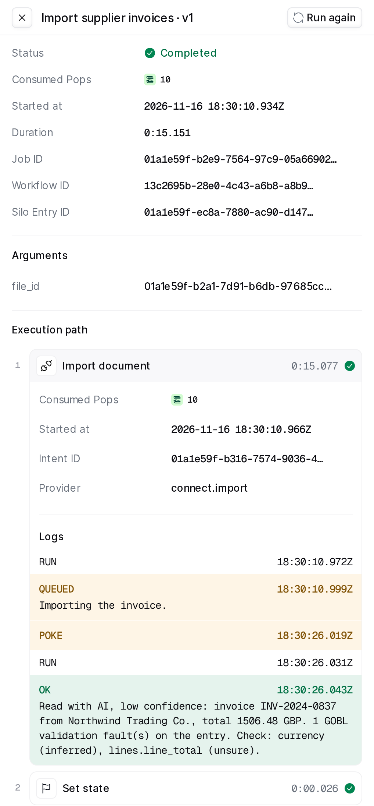</Frame>

The imported invoices are in **Invoices**, in the state your workflow gave them:

<Frame caption="Three imports, one of them waiting for a check">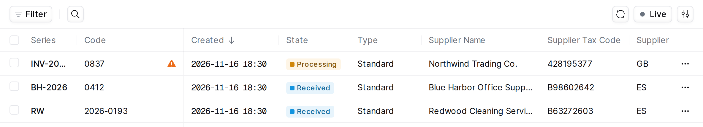</Frame>

Each entry has the original file attached. An invoice that doesn't validate is still stored, with its faults, so you can fix it: here the supplier's VAT number failed its check.

<Frame caption="The entry to check, with its fault and original file">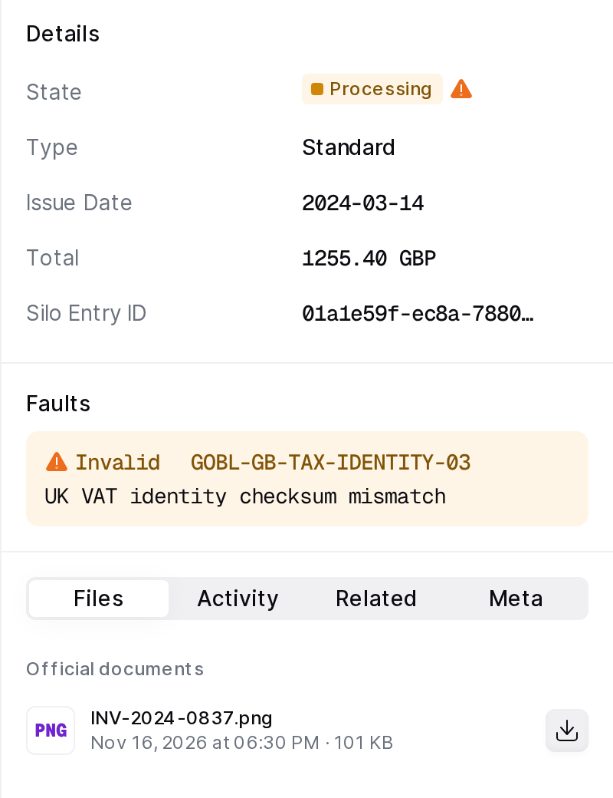</Frame>

Fix the entry with `Edit`, or ask the supplier for a corrected invoice. Running the workflow again on the same entry imports the file again and updates that entry, instead of creating another.

## Rules and profiles

Rules tell the AI what it can't know from the page: how your purchase order numbers look, which tax applies to a supplier's invoices, which GOBL addon to use. Each rule is one short instruction of up to 200 characters. Add them in the **Rules** tab.

<Frame caption="Two rules">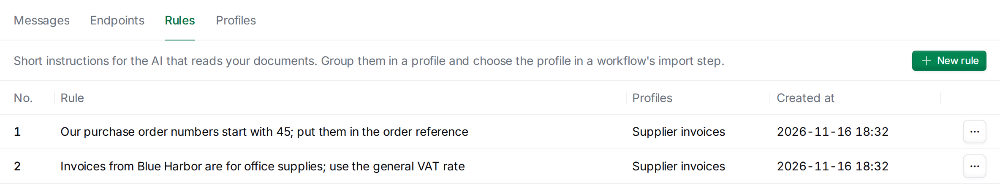</Frame>

A **profile** groups up to 10 rules, given to the AI in the profile's order. Create it in the **Profiles** tab, then choose it in the **Import document** step of your workflow. Different workflows can use different profiles.

<Frame caption="A profile with two rules">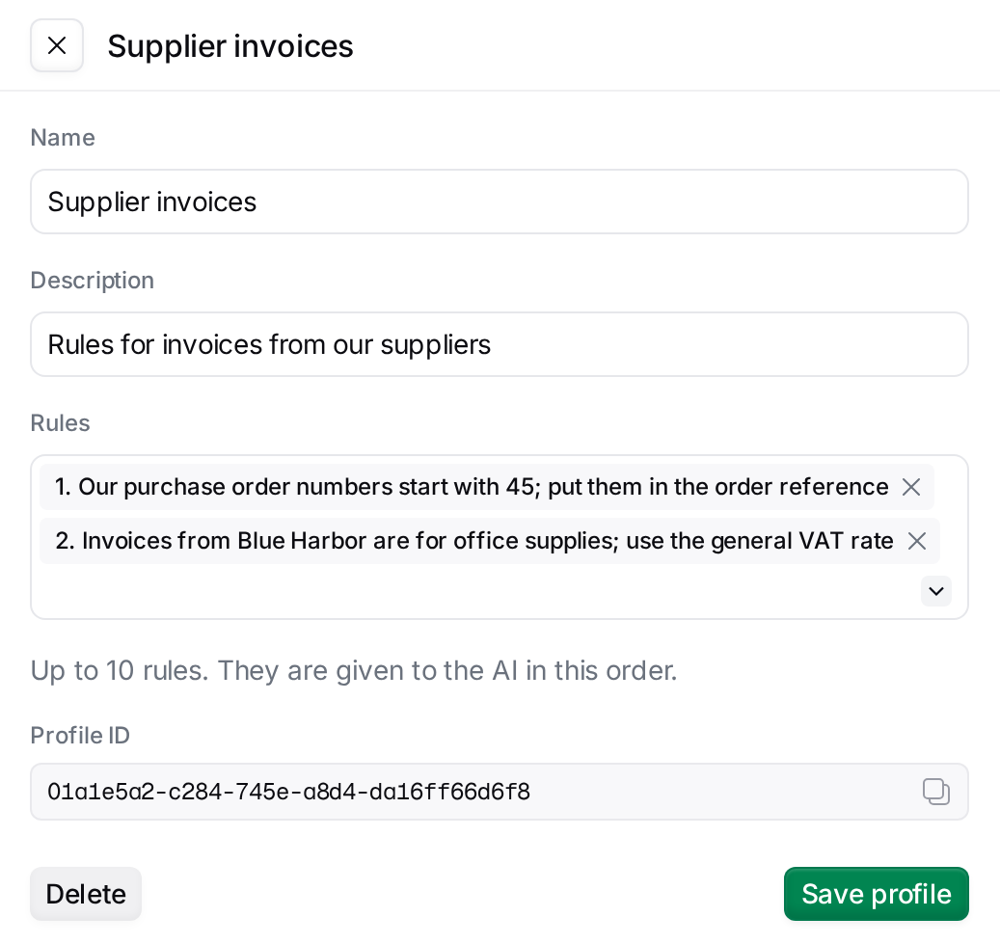</Frame>

A rule that names a GOBL addon sets it on the import, such as `Use the es-verifactu-v1 addon` or `Apply the VERI*FACTU addon`. A profile's rules can name one addon.

## Good to know

- **Limits**: files up to 25 MB, and up to 20 pages for a PDF read with AI. An email's first 20 attachments are read.
- **Not an invoice**: a document the AI finds isn't an invoice, such as a delivery note or a letter, fails the job with the reason and isn't charged.
- **Tampering**: text hidden in a PDF that disagrees with what's visible, or instructions addressed to the AI, make the import `low` and are quoted in the message, starting "Possibly tampered".
- **API**: endpoints, rules and profiles can also be managed with a workspace token. See the [Connect API reference](/api-ref/apps/connect/endpoints-create), which also covers getting what an import recorded for a silo entry.

<Card title="Participate in our community"
  icon="forumbee"
  href="https://community.invopop.com"
  arrow="true"
  horizontal
>
  Ask and answer questions about the Connect app →
</Card>
