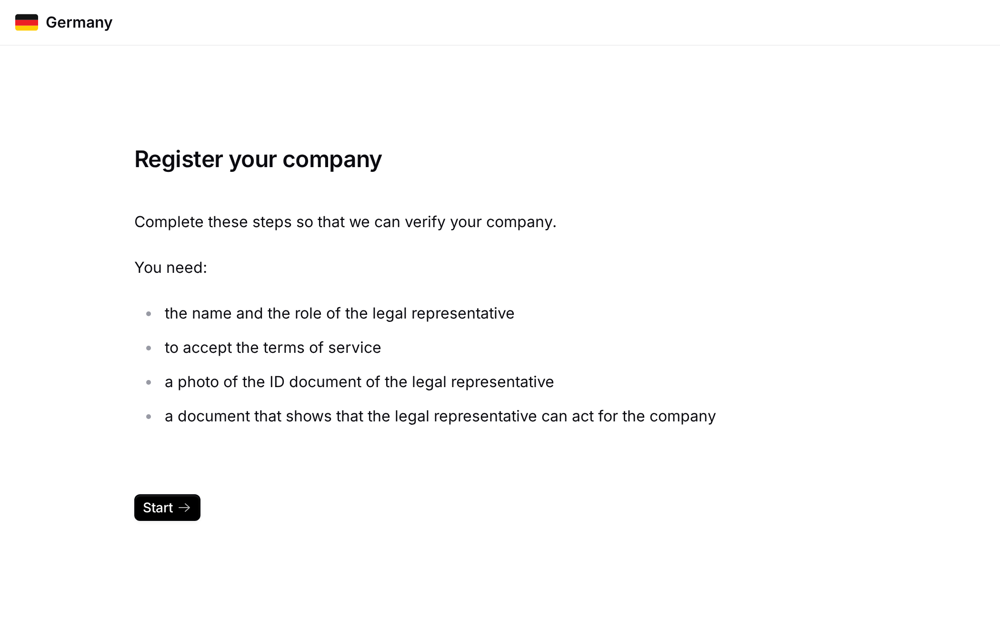
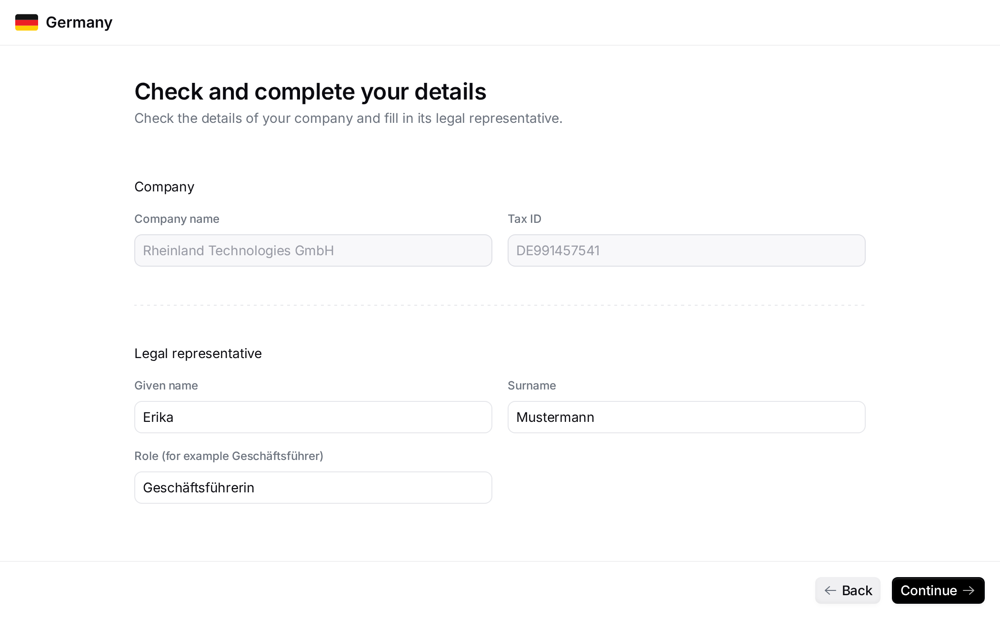
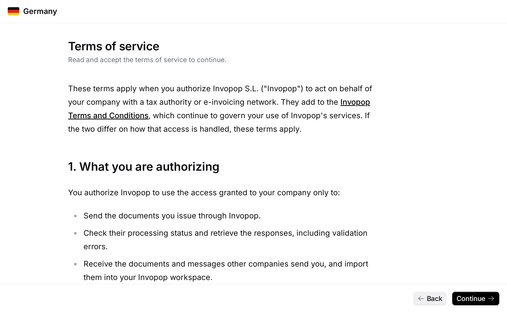
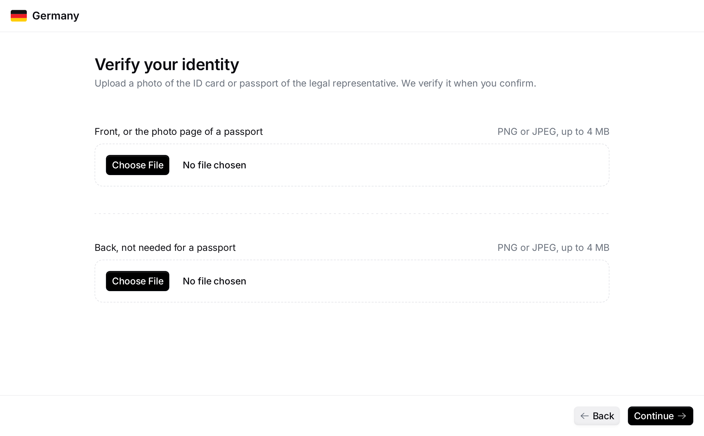
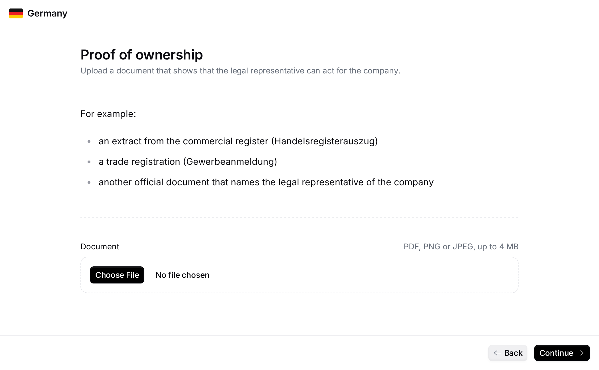
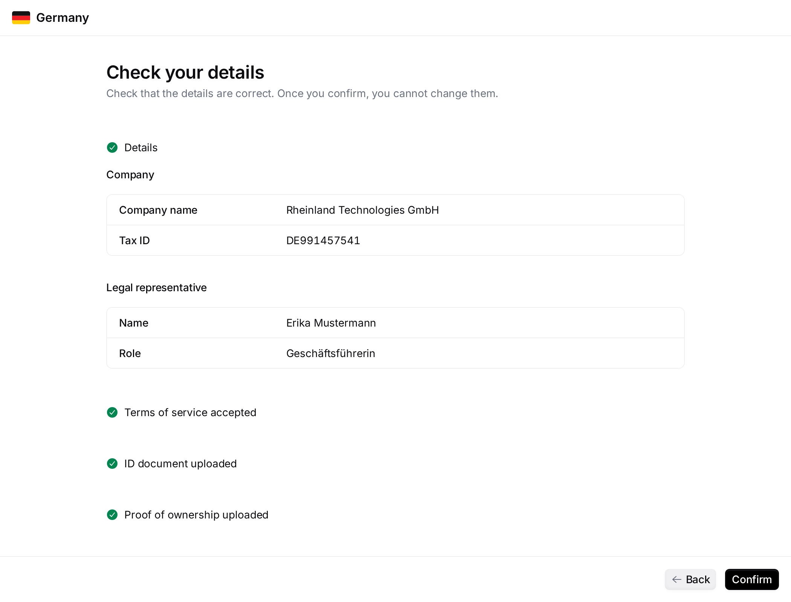
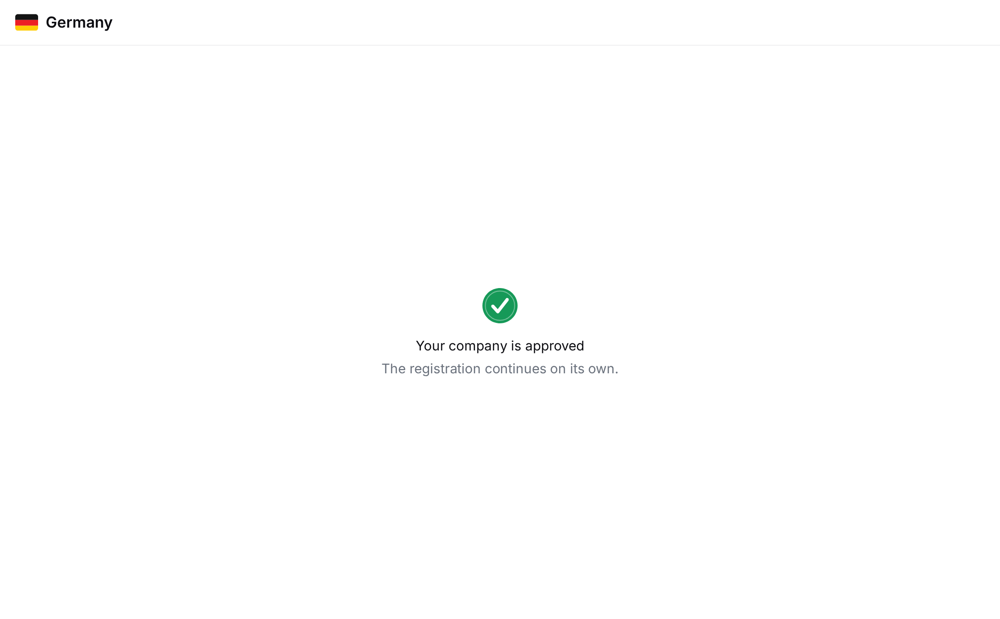

import GermanyResources from '/snippets/tables/germany-resources.mdx';
import Supplier from '/snippets/parties/de/supplier.mdx';
import RegisterWorkflow, { deRegisterWorkflow } from '/snippets/workflows/de/register.mdx';
import UnregisterWorkflow, { deUnregisterWorkflow } from '/snippets/workflows/de/unregister.mdx';
import FAQ from '/snippets/faqs/de/composers/guide-peppol-supplier.mdx';
import { WorkflowDiagram } from '/snippets/components/workflow.jsx';

## Introduction

Before a German supplier sends and receives invoices through [Peppol](/apps/peppol), Invopop approves it. The supplier's legal representative completes an onboarding that shows who can act for the company. The [Germany app](/apps/germany) runs the onboarding, and the Peppol app then registers the supplier.

Issuing XRechnung or ZUGFeRD files does not need this registration. For issuing invoices, see the companion guide: [Invoicing in Germany](/guides/de-invoicing).

| - | Sandbox | Live |
|---|---|---|
| **Onboarding** | Approved without verifying the ID document | The ID document is verified when the supplier confirms |
| **Network** | Peppol Test Network | Peppol Production Network |

<Info>In sandbox, set the configuration of the **Wait for supplier approval** step to `{"response": "reject"}` to test a rejection.</Info>

## Prerequisites

- **A German VAT ID** on the party. Registration adds the supplier's GEBA (`0246:DE…`, its VAT ID with the `DE` prefix) as its Peppol ID, unless the party already has a Peppol inbox.
- **The legal representative**, with a photo of their ID card or passport.
- **A proof of ownership**: a document that shows that the legal representative can act for the company, such as an extract from the commercial register (*Handelsregisterauszug*).

## Setup

All of the following steps must be carried out from the [Invopop Console](https://console.invopop.com).

<Steps>
  <Step title="Connect the Germany app">
    1. Navigate to **Configuration** → **Apps**.
    2. Find **Germany** in the app discovery list.
    3. Click **Connect** to activate.
  </Step>
  <Step title="Connect the Peppol app">
    Follow the [Peppol guide](/guides/peppol) to connect and configure the Peppol app.
  </Step>
  <Step title="Configure the supplier registration workflow">
    <Card iconType="duotone" title="Germany register supplier workflow" icon="code-branch" href="https://console.invopop.com/redirect/workflows/new?template=de-register" horizontal>
      Add to my workspace →
    </Card>
    <Tabs>
      <Tab title="Workflow">
        <WorkflowDiagram workflow={deRegisterWorkflow} />
      </Tab>
      <Tab title="Code">
        Copy and paste into a new [Empty Party workflow](https://console.invopop.com/redirect/workflows/new?template=empty-party) code view.

        <RegisterWorkflow />
      </Tab>
    </Tabs>
  </Step>
</Steps>

## Register a supplier

<Steps>
  <Step title="Upload the supplier">
    In the left sidebar, go to the **Parties** section and click **Suppliers**. Click **+ New Supplier**, paste the example below and adapt it. Click <kbd>Build</kbd> to validate the document, then <kbd>Save</kbd>.

    <Supplier />
  </Step>
  <Step title="Run the registration workflow">
    Click <kbd>Select Workflow</kbd>, choose the **Germany register supplier** workflow and click <kbd>Run Workflow</kbd>. The state of the entry changes to <Badge color="yellow">Processing</Badge>.

    The onboarding link appears in the entry's **Meta** tab, under `approval-link`. Send it to the supplier's legal representative.
  </Step>
  <Step title="Complete the onboarding">
    The legal representative follows the link and completes the [onboarding wizard](#the-onboarding-wizard).
  </Step>
  <Step title="Wait for the approval">
    When the supplier confirms, the workflow continues. It stores the approval on the party, registers the supplier on Peppol and sets the state to <Badge color="green">Registered</Badge>. If the approval is rejected, the workflow fails with the reason.
  </Step>
</Steps>

<Note>
  An approval covers the party as it was when it was approved. If the party changes after the approval, the workflow fails. Run it again, and the supplier completes a new onboarding.
</Note>

## The onboarding wizard

<Steps>
  <Step title="Start">
    <Frame caption="Start screen">
      
    </Frame>
    The first screen lists what the supplier needs.
  </Step>
  <Step title="Company details">
    <Frame caption="Company details screen">
      
    </Frame>
    The supplier checks the company name and tax ID, which come from the party, and fills in the legal representative.
  </Step>
  <Step title="Terms of service">
    <Frame caption="Terms of service screen">
      
    </Frame>
    The supplier accepts the terms of service on behalf of the company.
  </Step>
  <Step title="ID document">
    <Frame caption="ID document screen">
      
    </Frame>
    The supplier uploads a photo of the legal representative's ID card or passport.
  </Step>
  <Step title="Proof of ownership">
    <Frame caption="Proof of ownership screen">
      
    </Frame>
    The supplier uploads a document that shows that the legal representative can act for the company.
  </Step>
  <Step title="Confirm">
    <Frame caption="Confirmation screen">
      
    </Frame>
    The supplier checks the details and confirms. After this, the details cannot change.
  </Step>
  <Step title="Result">
    <Frame caption="Result screen">
      
    </Frame>
    The page shows the result. Once the company is approved, the registration continues on its own.
  </Step>
</Steps>

## Unregister a supplier

The unregistration workflow removes the supplier from Peppol, cancels an onboarding in progress and removes the approval.

<Warning>
  After an unregistration, a new registration starts a new onboarding, also when the party did not change.
</Warning>

<Card iconType="duotone" title="Germany unregister supplier workflow" icon="code-branch" href="https://console.invopop.com/redirect/workflows/new?template=de-unregister" horizontal>
  Add to my workspace →
</Card>
<Tabs>
  <Tab title="Workflow">
    <WorkflowDiagram workflow={deUnregisterWorkflow} />
  </Tab>
  <Tab title="Code">
    Copy and paste into a new [Empty Party workflow](https://console.invopop.com/redirect/workflows/new?template=empty-party) code view.

    <UnregisterWorkflow />
  </Tab>
</Tabs>

At this point, you're ready to start sending invoices on behalf of the supplier. Head over to the [Invoicing in Germany guide](/guides/de-invoicing) to continue.

## FAQ

<FAQ />

More available in our [Germany FAQ](/faq/germany) section

---

<GermanyResources />

<Card title="Participate in our community"
  icon="forumbee"
  href="https://community.invopop.com"
  arrow="true"
  horizontal
>
  Ask and answer questions about invoicing in Germany →
</Card>
