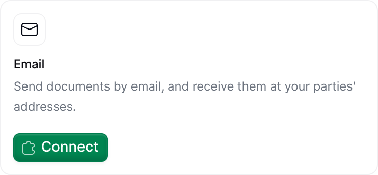
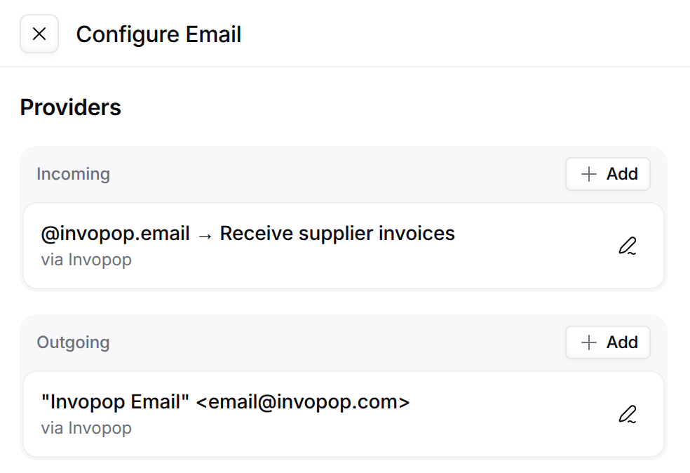
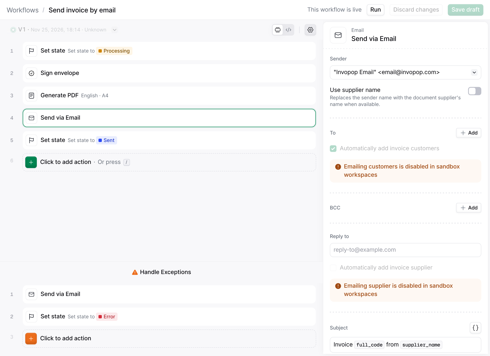
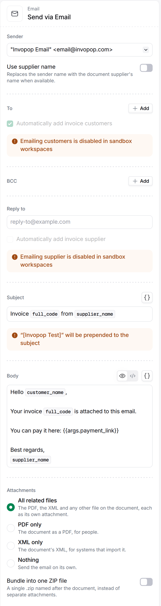
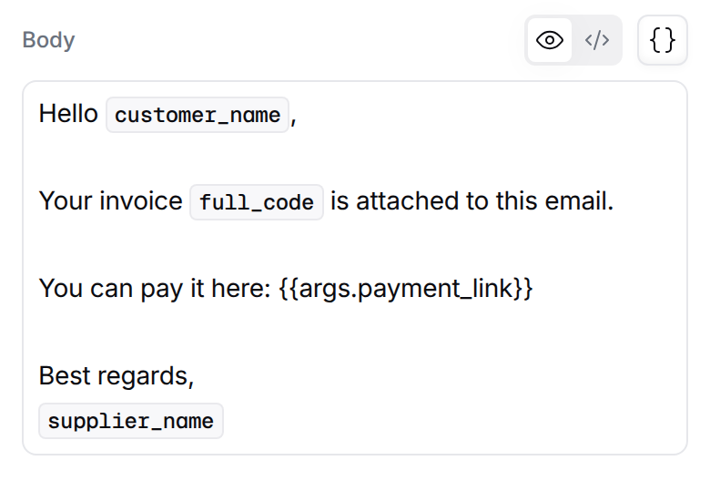
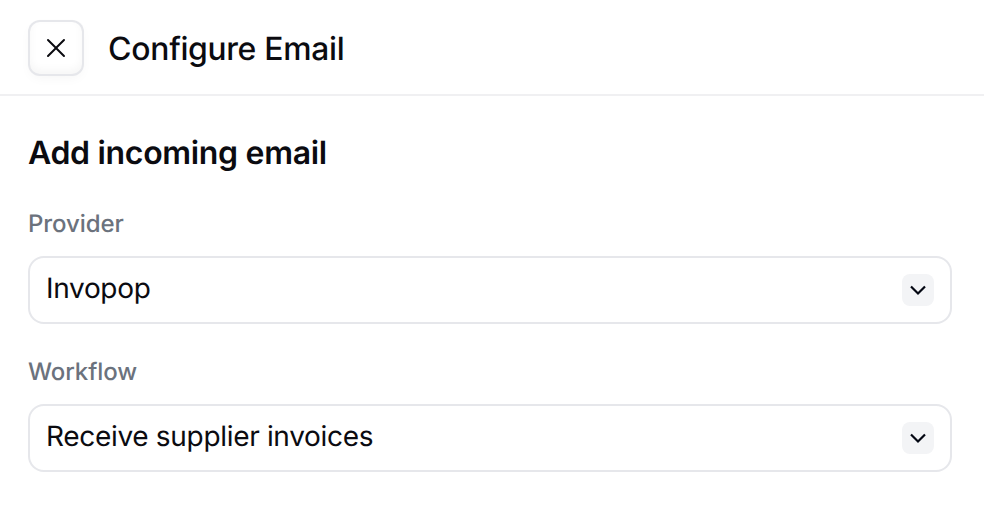
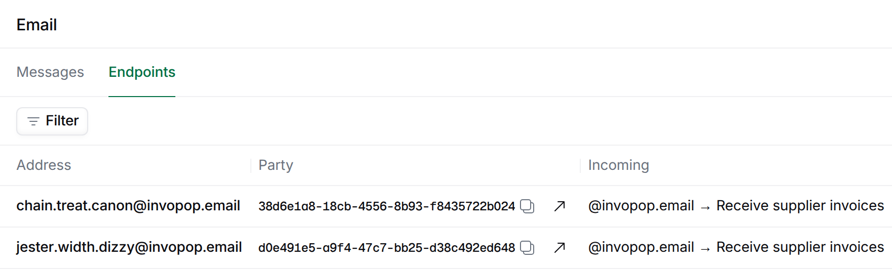
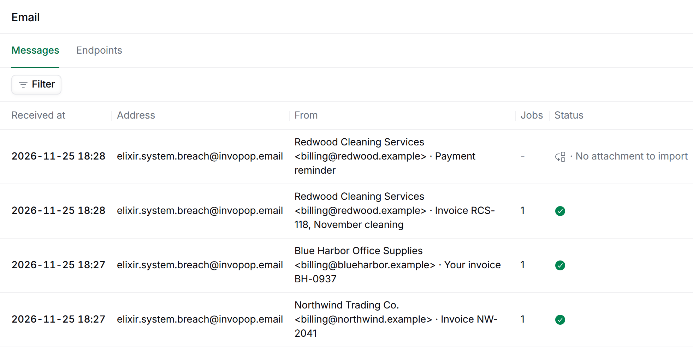
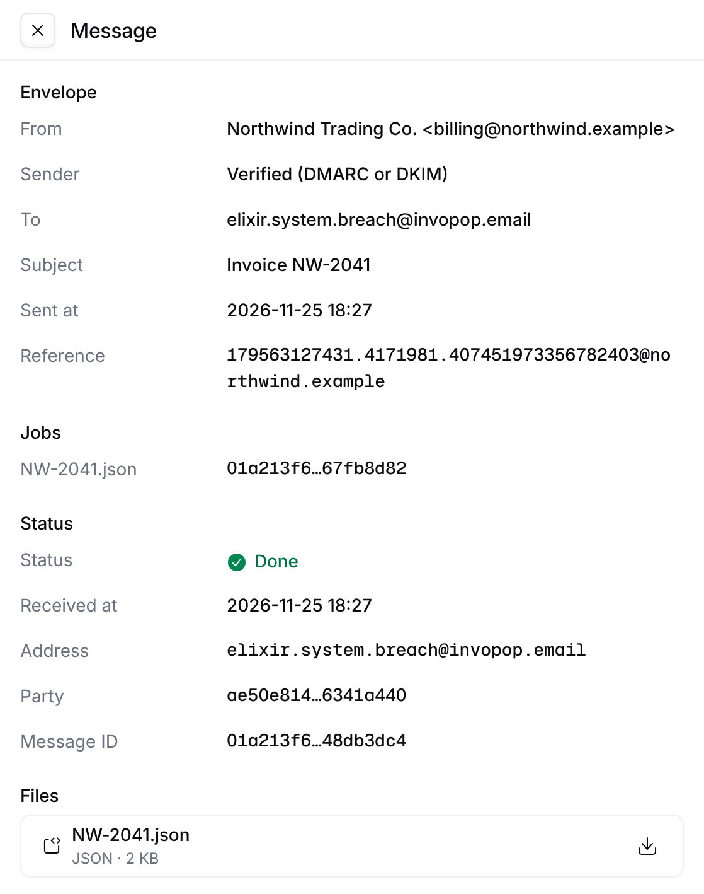
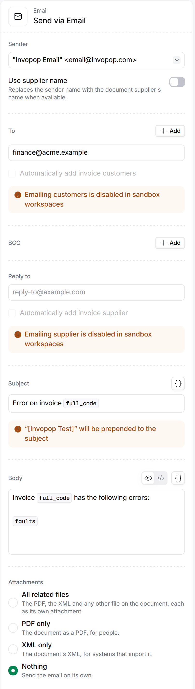

import { WorkflowDiagram } from '/snippets/components/workflow.jsx';
import EmailIncomingImportWorkflow, { emailIncomingImportWorkflow } from '/snippets/workflows/email/incoming-import.mdx';
import EmailIncomingRegisterWorkflow, { emailIncomingRegisterWorkflow } from '/snippets/workflows/email/incoming-register.mdx';
import EmailIncomingUnregisterWorkflow, { emailIncomingUnregisterWorkflow } from '/snippets/workflows/email/incoming-unregister.mdx';

## Introduction

This guide will show you how to set up the Email app and its associated workflow actions for emailing invoices or sending notifications, and for [receiving invoices by email](#receiving-invoices-by-email).

## Prerequisites

You can send emails from `Company name <email@invopop.com>` by simply connecting the Email app.

If you wish to send emails from your own domain such as `Company Name <name@yourdomain.com>`, you will need one of the following:

- A [Resend](https://resend.com) account with a [verified domain](https://resend.com/docs/dashboard/domains/introduction#verifying-a-domain)
- A [SendGrid](https://sendgrid.com) account with an [authenticated domain](https://www.twilio.com/docs/sendgrid/ui/account-and-settings/how-to-set-up-domain-authentication)
- An SMTP server which is authorized to send emails from your domain ([Gmail](https://support.google.com/a/answer/176600?hl=en), [iCloud](https://support.apple.com/en-us/102525), [Amazon SES](https://docs.aws.amazon.com/ses/latest/dg/send-email-smtp.html))

<Warning>In the case of SMTP delivery we strongly recommend using an _app password_ or _token_ if your service provider allows it. This is the best security practice because it allows you to revoke authorization at any time, even if you lose access to Invopop.</Warning>


## Setup

<Steps>

<Step title="Connect the Email app.">
Head over to `Configuration → Apps`, and find `Email` from the list of apps to discover. Tap the **Connect** button to enable.

    <Frame>
      
    </Frame>

</Step>

<Step title="Add Senders">

After connecting the Email app, click on `Configure`. You will find a pre-defined email address `Invopop Email <email@invopop.com>`. Editing this email address will allow you to customize the Sender name, allowing you to send emails with your company name `Company Name <email@invopop.com>`.

You can add as many senders as you need by tapping on the `Add` button under **Outgoing**. Email providers other than Invopop will allow you to use your own domain name (after it's configured with the email provider).

    <Frame caption="The Email app's providers: an incoming address domain and the default sender">
      " />
    </Frame>

</Step>


<Step title="Set up your workflow">

Whether you start from an existing or new workflow, make sure that you add the `Send email` step after you have issued an invoice via the corresponding tax authority and generated a PDF (if required). This will ensure the necessary files are attached, and that the invoice complies with local regulatory requirements.

<Frame caption="A workflow that signs the invoice, generates its PDF and emails it to the customer">
  
</Frame>

If you simply want to send a notification, this suggestion does not apply: a `Send via Email` step in a job without a document attaches no files.

</Step>


</Steps>

## Workflow actions

The Email app adds these items to your workflow action list:

1. **Send via Email**: sends an email. When the job has a silo entry, the entry's files are attached and its customer or supplier can be a recipient; this is how invoices are sent. Without one, nothing is attached, for notifications or failures.
2. **Register incoming endpoint**, **Unregister incoming endpoint** and **Import incoming document**: receive invoices by email, see [below](#receiving-invoices-by-email).

<Info>**Notify via Email** is now part of **Send via Email**. Existing steps that use it keep working as sends without attachments.</Info>

## Workflow step configuration

    <Frame>
      
    </Frame>

**Sender**<br />
Here you will find Senders which were added in the Email app configuration. A sender can be thought of as a person or company name and email address.

**To**<br />
Check `Automatically add invoice customers` if you wish to send the invoice as an attachment to the customer. This is usually the case for B2C workflows. If you wish to send the email with attachments to a specific address, tap on the `Add` button and write an address in the email field.

You can combine both options: any addresses you add manually are merged with the automatically detected customer or party emails, so all recipients receive the message.

**BCC**<br />
BCC stands for _Blind Carbon Copy_, and is used when you do not want the recipients in this field to appear in the message header. Other recipients won't know that a copy was sent to these addresses. This is useful to send a copy of the invoice to yourself, for example.

**Reply To**<br />
The "Reply To" field requires a valid email address where recipients' responses will be directed. This field determines where replies go, regardless of the sending address.

**Subject**<br />
The email subject field is a brief heading that summarizes your message's purpose. This field allows you to use template variables in order to customize the subject for the recipient.

<Tip>
  For maximum effectiveness, keep it clear and specific (e.g., "Invoice #12345 from Acme Inc."). Many email clients display only the first 60-70 characters of a subject, so prioritize key information at the beginning.
</Tip>

**Body**<br />
The email body textarea is where you compose your message's main content. This field allows template variables and will preserve whitespace.

**Combine attachments into a single zip file**<br />
It's possible that your workflow generates several files per invoice (sometimes an XML and a PDF file are required by legislation). This option allows you to combine and compress all files into a single `.zip` file.

***

## Custom template variables with job args

In addition to the predefined variables available in the **Insert variable** menu, you can inject custom variables into your email templates using job args. This is particularly useful for dynamic content like payment links, conditional text, and other external data.

### How it works

When [using the API to run a workflow](/api-ref/transform/jobs/create-a-job-put) you pass an `args` data object with custom variables you want to inject into your email. You will then introduce the variable into the email's subject or body with the following syntax: `{{args.variable_name}}`. If you need to provide a fallback in case the variable is not present, we recommend using the following syntax: `{{ or args.value "Default value" }}`.


### Example: adding a payment link

Let's say you want to send an email with a custom payment link. Here's how to set it up:

<Steps>
  <Step title="Configure your email template">
    In the email body field you can use both the document's variables (in this case `customer_name`, `full_code` and `supplier_name`) and custom variables such as `{{args.payment_link}}`.
    <Frame caption="Body field example with custom arguments">
      
    </Frame>

  </Step>

  <Step title="Execute the job with custom args">

     Arguments (`args`) are key-value pairs tailored to specific applications, in this case we are creating a `payment_link` which will be available to the Email App. [Create the job via API](/api-ref/transform/jobs/create-a-job-put) with the proper payload:

    ```json
      {
        "content_type": "application/json",
        "silo_entry_id": "...",
        "workflow_id": "...",
        "args": {
          "payment_link": "https://your-payment-link.com"
        }
      }
    ```
  </Step>
  <Step title="Verify result">
    The email recipient should receive an email with the following content:

    ```
    Hello John Doe,

    Your invoice INV-2025-001 is attached to this email.

    You can pay it here: https://your-payment-link.com

    Best regards,
    Invopop
    ```
  </Step>
</Steps>

<Info>
 **Key points**
- Use `{{args.variable_name}}` syntax in email templates for custom variables
- Include the same variable names in the `args` object when executing the job via API
- Custom variables work in both email body and subject fields
- Variable names must match exactly between template and API payload
</Info>

## Receiving invoices by email

The Email app can also receive invoices for your parties. Each registered party gets an address of its own, such as `clip.apple.leap@invopop.email`, and every invoice sent there is imported into your workspace, with that party as the customer. It suits accounts payable: give a supplier the address, and their invoices arrive as silo entries.

<Steps>

<Step title="Create the import workflow">
This workflow runs once for each invoice received. The **Import incoming document** step turns the document into GOBL, sets the receiving party as the customer, and attaches the files that came with it.

<Card iconType="duotone" title="Email receive invoice workflow" icon="code-branch" href="https://console.invopop.com/redirect/workflows/new?template=email-incoming-import" horizontal>
  Add to my workspace →
</Card>
<Tabs>
  <Tab title="Workflow">
    <WorkflowDiagram workflow={emailIncomingImportWorkflow} />
  </Tab>
  <Tab title="Code">
  Copy and paste into a new [Empty Invoice workflow](https://console.invopop.com/redirect/workflows/new?template=empty-invoice) code view.
  <EmailIncomingImportWorkflow />
  </Tab>
</Tabs>
</Step>

<Step title="Configure receiving in the Email app">
In `Configuration → Apps`, open the Email app's **Configure** page. Under **Providers**, in the **Incoming** section, add an incoming email connection: choose Invopop as the provider, and the import workflow from the previous step. Only workflows with the **Import incoming document** step are offered.

<Frame caption="An incoming connection">
  
</Frame>
</Step>

<Step title="Register your parties">
Run the registration workflow on each party (an `org/party` entry) that should receive invoices. The **Register incoming endpoint** step:

- uses the party's own address when it already has an email endpoint (`mailto:`) on the Invopop domain, unless another party holds it;
- fails when the party's email endpoints are all on other domains, as mail to those can't reach Invopop: remove them, or add one on the Invopop domain;
- otherwise creates a new address;
- adds the address to the party's meta, with a `mailto:` link. The party document isn't changed.

Running it again on a registered party is skipped and not charged. A registered party is charged 20 pops a month. When the app has more than one incoming connection, choose the connection in the step's settings.

<Card iconType="duotone" title="Email register party workflow" icon="code-branch" href="https://console.invopop.com/redirect/workflows/new?template=email-incoming-register" horizontal>
  Add to my workspace →
</Card>
<Tabs>
  <Tab title="Workflow">
    <WorkflowDiagram workflow={emailIncomingRegisterWorkflow} />
  </Tab>
  <Tab title="Code">
    Copy and paste into a new [Empty Party workflow](https://console.invopop.com/redirect/workflows/new?template=empty-party) code view.
    <EmailIncomingRegisterWorkflow />
  </Tab>
</Tabs>
</Step>

<Step title="Share the address">
Give the address to whoever sends the party's invoices. Every registered address is listed in the Email app's **Endpoints** tab, with its party.

<Frame caption="Two registered parties">
  
</Frame>

Each email that reaches it is listed in the Email app's **Messages** tab, with the jobs it started. An email with nothing to import is listed as skipped, with the reason.

<Frame caption="Three invoices imported, and a reminder with nothing to import">
  
</Frame>

Click a message to see who sent it, whether the sender was verified, the jobs it started, and its files.

<Frame caption="A received email">
  
</Frame>
</Step>

</Steps>

### What gets imported

Each invoice in an email becomes one job on the import workflow:

- **GOBL** documents (JSON) are stored as they are.
- **XML** invoices, such as UBL or CII, are converted to GOBL.
- **PDFs that carry their invoice as a file**, such as Factur-X or ZUGFeRD, are converted from that file.
- A **PDF sent with its XML** is attached to the XML's entry rather than imported on its own. They are matched by file name, by invoice number, or as the only XML and PDF in the email.

An XML that can't be converted fails its job with the reason, and the PDF sent with it isn't read instead. Anything else, such as a scanned PDF or a photo, fails its job saying the file couldn't be processed, and isn't charged. Logos and images in the email's body are left out, as are file types the app doesn't take, and emails with no sender. An email with several invoices in one PDF is split into one job per invoice. Up to 20 files are read from each email, each up to 25 MB.

### Unregistering a party

The **Unregister incoming endpoint** step releases the party's address and removes it from the party's meta. Email sent to the address afterwards is ignored.

<Card iconType="duotone" title="Email unregister party workflow" icon="code-branch" href="https://console.invopop.com/redirect/workflows/new?template=email-incoming-unregister" horizontal>
  Add to my workspace →
</Card>
<Tabs>
  <Tab title="Workflow">
    <WorkflowDiagram workflow={emailIncomingUnregisterWorkflow} />
  </Tab>
  <Tab title="Code">
    Copy and paste into a new [Empty Party workflow](https://console.invopop.com/redirect/workflows/new?template=empty-party) code view.
    <EmailIncomingUnregisterWorkflow />
  </Tab>
</Tabs>

***

**FAQ**

<AccordionGroup>

<Accordion title="How do I get errors emailed to me when a workflow fails?">

    <Frame caption="Send via Email configuration in a workflow's error handler">
      
    </Frame>

Add a **Send via Email** step to the error handling area at the end of your workflow. The error handler only runs when something upstream fails, so the email is sent just for failed jobs. Alternatively, if you handle the exception, add it in the exception handling area nested in the step.

Configure the step like this:

- **To** — your own address (or a shared inbox / distribution list).
- **Subject** — write a short label such as `Error on invoice`. You can use the <kbd>Insert variable</kbd> button to append the **Full Code** so you can identify which document failed.
- **Body** — describe the problem, then use <kbd>Insert variable</kbd> to add the **Full Code** and the **Faults** variable. `Faults` expands into the list of errors that caused the job to fail, so you get the full reason without opening the console.

For example, a body of `Invoice [Full Code] has the following errors: [Faults]` produces a message naming the document and listing every error.

Once saved, any job that fails will trigger this step and send you the error details automatically.
</Accordion>
<Accordion title="Is email in sandbox limited in any way?">

We strive to make our sandbox workspaces as similar to our live workspaces as possible. However, in order to prevent abuse and email mistakes, the following differences should be observed in Sandbox:

* Emailing customers is disabled in sandbox workspaces.
* Emailing suppliers is disabled in sandbox workspaces.
* Invoice PDFs will have a "Sample" watermark.
* `[Invopop Test]` will be prepended to the subject.

</Accordion>
<Accordion title="How do I set up Gmail as my SMTP server">
Follow [the instructions in this support guide](https://support.google.com/a/answer/176600?hl=en). Setting up an SMTP relay allows you more fine-grained control over your email needs and has the largest quota (up to 10,000 recipients per day); but can only be set up by an account administrator.

Gmail's SMTP server allows up to 2,000 emails per day. It can be set up by an end-user by creating an [app password](https://support.google.com/mail/answer/185833) and using the set-up configuration listed in the Google support guide.
</Accordion>

<Accordion title="How do I set up iCloud Mail">
Follow the instructions found in [iCloud Mail server settings for other email client apps](https://support.apple.com/en-us/102525).
</Accordion>
<Accordion title="How do I set up Microsoft 365">
Follow the instructions found in [How to set up a multifunction device or application to send emails using Microsoft 365 or Office 365](https://learn.microsoft.com/en-us/exchange/mail-flow-best-practices/how-to-set-up-a-multifunction-device-or-application-to-send-email-using-microsoft-365-or-office-365)
</Accordion>
<Accordion title="How do I set up Amazon SES">
Follow the instructions found in [Using the Amazon SES SMTP interface to send email](https://docs.aws.amazon.com/ses/latest/dg/send-email-smtp.html)
</Accordion>
<Accordion title="My custom variable displays as <no value>">
 This means the job's `args` key/value pair was not set. Ensure that you pass a value, even if it's empty:

     ```json
      {
        "content_type": "application/json",
        "silo_entry_id": "...",
        "workflow_id": "...",
        "args": {
          "payment_link": ""
        }
      }
    ```

Alternatively, you can handle undefined `args` by using a fallback:

```
{{or args.variable_name "Default value"}}
```
</Accordion>
</AccordionGroup>

<Card title="Participate in our community"
  icon="forumbee"
  href="https://community.invopop.com"
  arrow="true"
  horizontal
>
  Ask and answer questions about email integration →
</Card>
