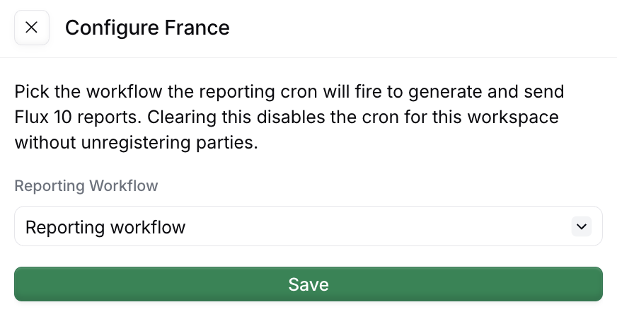

import FranceResources from '/snippets/tables/france-resources.mdx';
import { WorkflowDiagram } from '/snippets/components/workflow.jsx';
import SendWorkflow, { frReportingSendWorkflow } from '/snippets/workflows/fr/reporting-send.mdx';
import RecordWorkflow, { frReportingRecordWorkflow } from '/snippets/workflows/fr/reporting-record.mdx';
import FAQ from '/snippets/faqs/fr/composers/guide-pa-reporting.mdx';

E-reporting covers everything that is out of scope for regulated e-invoicing (B2C sales, cross-border B2B, and any flow where one party is not registered in the Annuaire). Instead of routing each invoice individually, you **record** each invoice and payment, Invopop generates a Flux 10 XML for each reporting window, and sends it to the PPF.

Invoices and payments must declare the [fr-ctc-flow10-v1](https://docs.gobl.org/addons/fr-ctc-flow10-v1) add-on in `$addons`: GOBL applies the Flux 10 rules when the document is built, and the record step rejects documents that don't carry the add-on.

## Sub-flows

Each recorded document is classified into one of four sub-flows based on supplier and customer SIREN:

| Flow  | Scope                         |
|-------|-------------------------------|
| `10.1` | International B2B invoices    |
| `10.2` | International B2B payments    |
| `10.3` | Domestic B2C invoices         |
| `10.4` | Domestic B2C payments         |

## Reporting windows

Records are grouped into reporting windows, and each window gets one report. Reports are kept separate per declarant SIREN, per kind (transactions `tx` and payments `py`) and per role (seller or buyer). Windows follow Paris time.

The cadence depends on the declarant's [VAT regime](#picking-a-vat-regime-at-supplier-registration):

| VAT regime | Transactions | Payments |
|---|---|---|
| `real_normal_monthly` (default) | 10-day | Monthly |
| `real_normal_quarterly` | Monthly | Monthly |
| `simplified` | Monthly | Monthly |
| `franchise` | Two-month | Two-month |

Each window has a name, which is also the format of the [`window` argument](#triggering-a-report-manually):

| Cadence | Windows | Names |
|---|---|---|
| 10-day | 1–10, 11–20, and 21 to the end of the month | `2026-SEP-1`, `2026-SEP-2`, `2026-SEP-3` |
| Monthly | The calendar month | `2026-SEP-1` |
| Two-month | January–February, March–April, and so on to November–December | `2026-JAN-1`, `2026-MAR-1` (there is no `2026-AUG-1`) |

A document goes into the window that is open when it is **recorded**, not the window of its issue or payment date. A late document, even one that is months old, is reported in the next report instead of being left out. 

## Recording workflow

Every invoice and payment that requires reporting goes through a single **Record** workflow. The action looks at the supplier and customer SIRENs and files the document into the right sub-flow (10.1 to 10.4) ready for the next report.


  <Card iconType="duotone" title="PPF record document for reporting" icon="code-branch" href="https://console.invopop.com/redirect/workflows/new?template=fr-reporting-record" horizontal>
    Add to my workspace →
  </Card>
<Tabs>
  <Tab title="Workflow">
    <WorkflowDiagram workflow={frReportingRecordWorkflow} />
  </Tab>
  <Tab title="Code">
    <RecordWorkflow />
  </Tab>
</Tabs>

### Payments

For `10.2` international B2B payments set `lines[i].document` on the payment to the invoice it settles. The minimum reference is the invoice number and issue date:

```json
{ "code": "INVOICE-NUMBER", "issue_date": "2026-05-15" }
```

This is what tells the record action to file the payment as `10.2` (international B2B payment) rather than `10.4` (domestic B2C payment), and allows GOBL to allocate the cashed amount across the invoice's VAT rates for you.

For B2C payments (`10.4`), specify the tax breakdown directly on the payment line:

```json
"lines": [
  {
    "amount": "120.00",
    "tax": {
      "categories": [
        {
          "code": "VAT",
          "rates": [{ "base": "100.00", "percent": "20%", "amount": "20.00"}]
        }
      ]
    }
  }
]
```

### Exemption reasons

Lines using `exempt`, `reverse-charge`, `intra-community`, `export`, or `outside-scope` rates must include a free-text reason. Add it to the invoice's tax block:

```json
{
  "tax": {
    "notes": [
      {
        "cat": "VAT", 
        "key": "intra-community", 
        "text": "Exonération article 262 ter I du CGI — livraison intracommunautaire"
      }
    ]
  }
}
```

The `key` must match the rate used on the line. Lines on `standard` or `zero` rates do not need a note.

### Correcting a recorded document

You can correct a recorded document in two ways:

| Action | How | Record | Window | Report already generated | When allowed |
|---|---|---|---|---|---|
| **Re-record** | Run the record workflow again on the same silo entry | Updated with the new data | Keeps its original window | The record leaves it; the next report for its window includes it | Any time, with no deadline, unless the report holding the document is <Badge color="blue">Submitted</Badge> (awaiting the PPF's answer) or <Badge color="green">Filed</Badge> (accepted) |
| **Unrecord** | Run the `gov-fr.reporting.unrecord` action against the silo entry | Deleted | If recorded again later, goes into the window open then | Left out of the next report | Same as re-record |

Whether you can do either depends on the [status](#reading-generated-reports) of the report holding the document:

| Report holding the document | Re-record | Unrecord | How to fix |
|---|---|---|---|
| None yet | Yes | Yes | Re-record or unrecord. The window's report picks up the change when it is generated. |
| <Badge color="gray">Generated</Badge>, not sent | Yes | Yes | Re-record or unrecord, then [generate the window's report again](#triggering-a-report-manually). |
| <Badge color="red">Rejected</Badge> | Yes | Yes | Re-record or unrecord, then [generate the window's report again](#triggering-a-report-manually). |
| <Badge color="blue">Submitted</Badge>, awaiting the PPF's answer | No | No | Wait for the answer. If the PPF rejects the report, fix it as above. |
| <Badge color="green">Filed</Badge>, accepted by the PPF | No | No | Issue a credit note and record it. |

A credit note for an accepted report is reported in the window open when it is recorded, as part of that window's normal report, not as a corrective of the original report.

#### Examples

These examples use 10-day windows, so `2026-SEP-1` runs from 1 to 10 September and `2026-SEP-2` from 11 to 20 September.

<AccordionGroup>
  <Accordion title="The PPF rejected the report">
    An invoice recorded on 4 September goes into `2026-SEP-1`. The window's report is generated and sent after 10 September, and the PPF rejects it because of an error on the invoice. Fix the invoice and run the record workflow again: the record keeps `2026-SEP-1` and leaves the rejected report. Then run the send workflow with `window` set to `2026-SEP-1` to generate and send a new initial report for the window.
  </Accordion>
  <Accordion title="The PPF accepted the report">
    The `2026-SEP-1` report holding an invoice was accepted, and on 15 September you find a wrong amount on it. Re-recording or unrecording the invoice fails. Issue a credit note for the invoice (and a new invoice if needed) and record it: it goes into `2026-SEP-2` and is reported with that window's normal report.
  </Accordion>
  <Accordion title="A document was never recorded">
    An invoice issued on 28 August was never recorded, and you notice on 14 September. Record it then: it goes into `2026-SEP-2`, the window open on 14 September, and is reported with that window.
  </Accordion>
  <Accordion title="Unrecord, then record again later">
    An invoice recorded on 8 September goes into `2026-SEP-1`. On 9 September you unrecord it, so it isn't reported with that window. When you record it again on 12 September, it goes into `2026-SEP-2`. Had you re-recorded it on 9 September instead, it would have stayed in `2026-SEP-1`.
  </Accordion>
</AccordionGroup>

## Submitting reports

A separate workflow bundles the records for a closed reporting window into a single Flux 10 report and sends it to the PPF. Invopop runs it automatically for each window, so you do not need to trigger it. The schedule won't generate a window again that already has a report: after a rejection, [trigger the report manually](#triggering-a-report-manually) for that window. Each scheduled run creates a job with **no silo entry**: the declarant SIREN and the stream being reported travel as job arguments.

<Card iconType="duotone" title="PPF generate and send reporting document" icon="code-branch" href="https://console.invopop.com/redirect/workflows/new?template=fr-reporting-send" horizontal>
  Add to my workspace →
</Card>
<Tabs>
  <Tab title="Workflow">
    <WorkflowDiagram workflow={frReportingSendWorkflow} />
  </Tab>
  <Tab title="Code">
    <SendWorkflow />
  </Tab>
</Tabs>

<Info>
  Tell Invopop which workflow to run on the schedule: in the **Apps** view, open the **France** app, click **Configure** to open the configuration sidebar, and select this workflow under **Reporting Workflow**.
</Info>

<Frame caption="Selecting the reporting workflow in the France app configuration sidebar">
  
</Frame>

### Triggering a report manually

You can also run the workflow yourself: useful for testing, to bring a party up to date after onboarding, or to generate a window's report again after a [correction](#correcting-a-recorded-document). There are two ways to tell the workflow which declarant to report:

- **Job arguments** — create the job with no silo entry and pass the SIREN in `args`. This is what the scheduler does.
- **A silo entry** — run the job against the registered party's silo entry, as any other workflow.

Whichever you choose, the stream being reported is selected the same way:

| Argument | Required | Values |
|---|---|---|
| `siren` | Only without a silo entry | The declarant's 9-digit SIREN. Takes precedence over the silo entry when both are given. |
| `flux-kind` | No | `tx` for transactions, `py` for payments. Falls back to the step configuration. |
| `role` | No | `seller` or `buyer`. Falls back to the step configuration. |
| `window` | No | A specific closed window to report, such as `2026-SEP-1`. See below. |

<CodeGroup>

```bash Job arguments
curl -X POST "https://api.invopop.com/transform/v1/jobs" \
  -H "Authorization: Bearer $TOKEN" \
  -H "Content-Type: application/json" \
  -d '{
    "workflow_id": "<REPORTING_WORKFLOW_ID>",
    "args": { "siren": "<SIREN>", "flux-kind": "tx", "role": "seller" }
  }'
```

```bash Silo entry
curl -X POST "https://api.invopop.com/transform/v1/jobs" \
  -H "Authorization: Bearer $TOKEN" \
  -H "Content-Type: application/json" \
  -d '{
    "workflow_id": "<REPORTING_WORKFLOW_ID>",
    "silo_entry_id": "<PARTY_SILO_ENTRY_ID>",
    "args": { "flux-kind": "tx", "role": "seller" }
  }'
```

</CodeGroup>

<Note>
  `window` is for testing and recovery. Name it `YEAR-MONTH-STEP`, as listed under [reporting windows](#reporting-windows). Any window that has closed is accepted. 
</Note>


### Picking a VAT regime at supplier registration

If you have a single supplier, or all your suppliers have the same cadence, you can configure the **Register party for reporting** step in the [PPF register supplier workflow](/guides/fr-pa-registration#ppf-register-supplier-workflow) to a specific cadence.

For multiple suppliers (whitelabel use cases) where different suppliers have different cadence, pass it as a job argument with key `vat-regime` when creating the job. When not stated, the default is `real_normal_monthly`.


| VAT regime | `args.vat-regime` |
|---|---|
| Monthly Actual (default) | `real_normal_monthly` |
| Quarterly Actual | `real_normal_quarterly` |
| Simplified VAT | `simplified` |
| Non-Established Taxpayer | `franchise` |


The cadence must match the regime registered with the tax office. If in doubt, check with your local accountant.

## Reading submitted transactions

The France dashboard's **Transactions Flow 8 / 9** tab lists every document submitted for e-reporting. In the Console, open the **Apps** view, select the **France** app, and switch to the **Transactions Flow 8 / 9** tab.

The tab shows one sub-flow at a time: the Flow type filter is always active, defaults to International B2B invoices (`10.1`), and switches between the four [sub-flows](#sub-flows). It can be changed but not cleared.

Each row shows the Document code and Document date, when it was Recorded, whether a report already covers it (Generated report), the Supplier SIREN, the *low type, the Role (Seller or Buyer; domestic B2C rows carry no role), the Silo entry, and the amounts the report will carry: Currency, Taxable total, Tax total (EUR), Amount (EUR), and FX rate, plus the counterparty identification and, on B2C rows, the category code.

<Note>
Clicking on the Generated report column opens the [Reporting Flow 10 tab](#reading-generated-reports) filtered to that report. A dash means the row is still waiting for its reporting window to close.
</Note>

Filter the table by **Document code**, **Supplier SIREN**, **Flow type**, or the **Recorded** date range.

## Reading generated reports

The **Reporting Flow 10** tab lists the generated Flow 10 XML reports.

Each row shows the Reporting period the report covers, the SIREN, the Kind (Transactions for invoice data, Payments for payment data), the Role of the stream (Seller, Buyer), the submission Status, the report Sequence number, the PPF Ack ref, the Submitted at timestamp, and the Period ID.

| Status | Meaning |
|---|---|
| <Badge color="gray">Generated</Badge> | The XML is built but not yet sent. |
| <Badge color="blue">Submitted</Badge> | Sent to the PPF; awaiting acknowledgement. |
| <Badge color="green">Filed</Badge> | Acknowledged by the PPF. |
| <Badge color="red">Rejected</Badge> | The PPF rejected the report. |

Click options on this tab:

<Note>
Clicking Download fetches the exact XML submitted to the PPF, the same payload the [`/xml` endpoint](#reading-whats-filed) returns.
</Note>

Filter the table by **SIREN**, **Period ID**, the **Reporting period** window, or **Kind**.

## Reading what's filed

These endpoints expose submission status and the raw report XML, all scoped to the party's SIREN. The party's silo entry ID is still accepted in its place.


<Badge color="green" size="sm">GET</Badge> `/v1/reports/:siren` <br /> 
Summary per kind (current window, next deadline, last filed report)
 
<Badge color="green" size="sm">GET</Badge> `/v1/reports/:siren/periods` <br />
Paginated history of filed periods (filter with `?kind=tx` or `?kind=py`)

<Badge color="green" size="sm">GET</Badge> `/v1/reports/:siren/periods/:period_id` <br />
A single period's metadata

<Badge color="green" size="sm">GET</Badge> `/v1/reports/:siren/periods/:period_id/xml` <br />
The raw report XML sent to the PPF

<Badge color="green" size="sm">GET</Badge> `/v1/reports/:siren/preview?kind=tx` <br />
The current window's report as it stands, built on the fly and never stored or sent. Useful for testing: pass `kind=py` for payments and `role=buyer` for the buyer stream.

## FAQ

<FAQ />

More available in our [France FAQ](/faq/france) section

---

<FranceResources />
