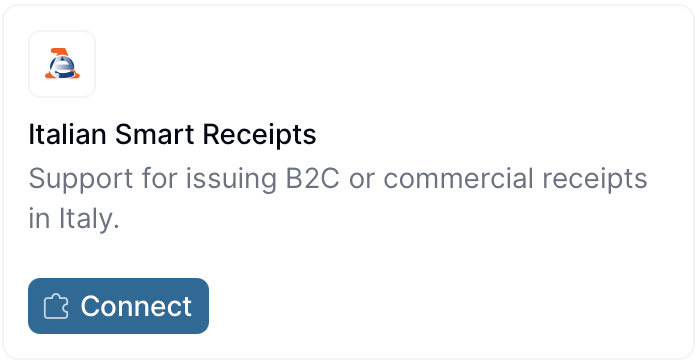
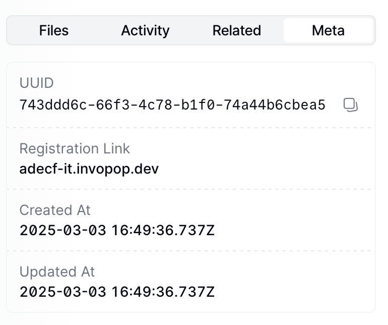
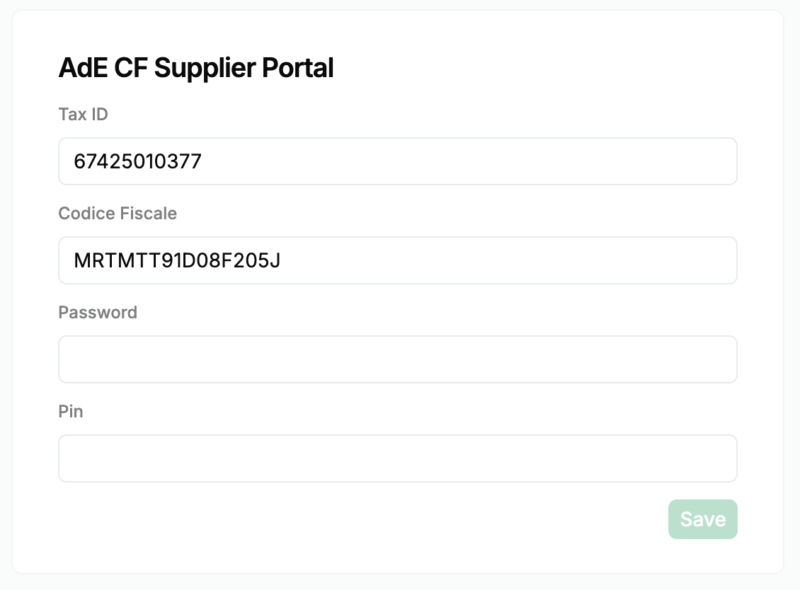

import PostRegistrationFlow, { itSdiPostRegistrationFlowWorkflow } from '/snippets/workflows/it/sdi-post-registration-flow.mdx';
import TicketRegisterSupplier, { itTicketRegisterSupplierWorkflow } from '/snippets/workflows/it/ticket-register-supplier.mdx';
import TicketUnregisterSupplier, { itTicketUnregisterSupplierWorkflow } from '/snippets/workflows/it/ticket-unregister-supplier.mdx';
import ItalyResources from '/snippets/tables/italy-resources.mdx';
import FAQ from '/snippets/faqs/it/composers/guide-ticket-supplier.mdx';
import { WorkflowDiagram } from '/snippets/components/workflow.jsx';

## Introduction

Before a company can issue electronic tickets (_documento commerciale/scontrino elettronico_) in Italy, they must be registered as a supplier in Invopop with the credentials they use on the _Agenzia delle Entrate_ (AdE) portal, so that receipts can be relayed to the AdE on their behalf.

In this guide you'll learn how to register a supplier using the [Smart Receipts Italy app](/apps/smart-receipts-italy). Once a supplier is registered, continue with the companion guide: [Italy: Issuing receipts](/guides/it-ticket).

| - | Sandbox | Live |
|---|---|---|
| **Supplier** | Test data accepted | Real Partita IVA and AdE credentials required |

## Prerequisites

To register a supplier for Smart Receipts, you will need:

- The supplier's Italian tax ID (Partita IVA). This identifies the business the receipts are filed under.
- The Fisconline login of a person authorised to act for the supplier on the [AdE portal](https://ivaservizi.agenziaentrate.gov.it/portale/): their personal _codice fiscale_, password and PIN. These are the same three values that person types to log in to the portal.

A company always acts on the AdE portal through a person, so the _codice fiscale_ is that person's own 16-character code, not the company's. The person doesn't need to be the owner or the legal representative:

- **Accepted:** anyone the company has appointed in AdE as _incaricato_, either _gestore incaricato_ or _operatore incaricato_ (for example the legal representative, an employee or the company's accountant).
- **Not accepted:** a _delega_ (delegation to an intermediary). Smart Receipts can't be used through a _delega_, so an accountant needs to be appointed as _incaricato_ instead.
- **Not supported:** SPID and CIE logins. The person needs Fisconline credentials (password and PIN).

<Tip>
  Before submitting the credentials, have the person log in to _Fatture e Corrispettivi_ with them, choose **Incaricato**, select the company and check they can open the _Corrispettivi_ section. If the appointment isn't active yet, the registration form is still accepted but receipts fail with `invalid-credentials` until the credentials are submitted again once it's active.
</Tip>

## Setup

There are three key processes to prepare:

1. Create a supplier post-registration workflow.
2. Connect the Italian Smart Receipts app.
3. Configure a supplier registration workflow.

<Info>
These instructions work in both sandbox and live environments. The only differences are in supplier data and registration details when using test environments.
</Info>

Follow these steps in the [Invopop Console](https://console.invopop.com).

<Steps>
<Step title="Create Supplier post-registration workflow">


<Card iconType="duotone" title="Smart Receipts supplier post-registration workflow" icon="code-branch" href="https://console.invopop.com/redirect/workflows/new?template=it-ticket-post-registration" horizontal>
  Add to my workspace →
</Card>
<Tabs>
  <Tab title="Workflow">
    <WorkflowDiagram workflow={itSdiPostRegistrationFlowWorkflow} />
  </Tab>
  <Tab title="Code">
    Copy and paste into a new [Empty Party workflow](https://console.invopop.com/redirect/workflows/new?template=empty-party) code view.
    <PostRegistrationFlow />
  </Tab>
</Tabs>
</Step>

<Step title="Connect the Italian Smart Receipts app">

1. Navigate to **Configuration** → **Apps**.
2. Find **Italian Smart Receipts** in the app discovery list.
3. Click **Connect** to activate.

<Frame>
  
</Frame>

Click the **Configure** button on the app, and choose the "Post-registration workflow" we created in the previous step.

Click the **Save** button.

</Step>

<Step title="Configure the supplier registration workflow">


<Card iconType="duotone" title="Smart receipts supplier registration workflow" icon="code-branch" href="https://console.invopop.com/redirect/workflows/new?template=it-ticket-register-supplier" horizontal>
  Add to my workspace →
</Card>
<Tabs>
  <Tab title="Workflow">
    <WorkflowDiagram workflow={itTicketRegisterSupplierWorkflow} />
  </Tab>
  <Tab title="Code">
    Copy and paste into a new [Empty Party workflow](https://console.invopop.com/redirect/workflows/new?template=empty-party) code view.
    <TicketRegisterSupplier />
  </Tab>
</Tabs>
</Step>

</Steps>

## Register a supplier

You can register suppliers either manually via the Invopop Console or programmatically via the API. The process is essentially the same. We'll demonstrate the manual process first, followed by the [API flow](#register-a-supplier-via-the-api).

<Warning>
  Suppliers in Italy using this system must generate and provide their [AdE](https://ivaservizi.agenziaentrate.gov.it/portale/)
  credentials so that invoices can be processed on their behalf. This is not an automated service and can only be
  performed manually by a representative of the supplier.
</Warning>

1. Navigate to **Parties** → **Suppliers** in the sidebar
2. Click **+ New Supplier**
3. In the editor, enter the supplier details

Here's an example using test data (only valid for sandbox environments):

<AccordionGroup>

<Accordion title="View supplier Data for sandbox">
```json
{
    "$schema": "https://gobl.org/draft-0/org/party",
    "uuid": "018fbeda-bc61-7000-b66d-398ce3e21c43",
    "name": "Milano Pizza",
    "tax_id": {
        "country": "IT",
        "code": "48220010093"
    },
    "identities": [
        {
            "key": "it-fiscal-code",
            "code": "MRTMTT91D08F205J"
        }
    ]
}
```
<Info>
  The `it-fiscal-code` identity is optional and only pre-fills the _Codice Fiscale_ field of the registration form. If included, it must be the personal _codice fiscale_ of the person whose Fisconline credentials will be submitted (see [Prerequisites](#prerequisites)), not the company's Partita IVA. The Partita IVA `48220010093` above is test data and only works in sandbox.
</Info>
</Accordion>

</AccordionGroup>


Tap **Build**, ensure there are no errors, and click **Save**.

We should now see the document. Find and click the **Select Workflow** button. Select the **Register Supplier** workflow created during setup, and click **Run Workflow**.

The execution should be successful, and the silo entry will now be in the `Processing` state. Tap the **Meta** tab to see the registration link:

<Frame>
  
</Frame>

<Info>
  You can access the registration link via the API by [fetching the silo
  entry](/api-ref/silo/entries/fetch-an-entry) and reading the `meta` row where
  the `key` is set to `registration-link`.
</Info>

Tap the registration link and a new browser window will be presented with a form to upload the credentials for the supplier. Note that this form can be shared directly with the supplier if required.

<Frame>
  
</Frame>

The details from this form are sent securely to our local partner who will be responsible for sending them to the AdE.
We will update the supplier with the provided _codice fiscale_ for future use but will not store any type of credentials.

<Warning>
  These credentials will expire every 90 days. You must first update your credentials on the official AdE web portal, then enter these new credentials in our registration form. You can use the same registration link to update your credentials.
</Warning>

If the credentials expire before they're renewed, the supplier's next receipt, refund or void fails: the step ends `KO` with the fault code `invalid-credentials` ("Please update the credentials for the supplier"). The code appears in the [job's faults](/api-ref/transform/jobs/fetch-a-job#response-faults) and in the `faults` of a [webhook](/guides/webhooks) step in the workflow's error flow. Invopop doesn't warn before the 90 days are up, so track the renewal date on your side, and use that fault code to prompt the supplier to renew through the same registration link. Sandbox doesn't check credentials, so this case can only happen in live.

At this point, you're ready to start issuing receipts on behalf of the supplier. Head over to the [Smart Receipts issuing guide](/guides/it-ticket) to continue.

## Register a supplier via the API

The whole registration process can also be completed programmatically. This is useful in [white-label](/guides/white-label) setups where you want to collect the supplier's credentials inside your own product instead of sharing Invopop's hosted form.

<Steps>
  <Step title="Upload the supplier">
    Use the [Create an entry](/api-ref/silo/entries/create-an-entry-put) endpoint to upload the supplier [party](https://docs.gobl.org/draft-0/org/party), like the example in the previous section. The party must include the company `name` and an Italian `tax_id` (Partita IVA). Optionally include the `it-fiscal-code` identity and an email address to pre-fill the registration form.
  </Step>
  <Step title="Run the registration workflow">
    Send the supplier to the registration workflow using the [Create a job](/api-ref/transform/jobs/create-a-job-put) endpoint with the IDs of the **silo entry** and the **supplier registration workflow** created during setup.
  </Step>
  <Step title="Fetch the registration link">
    [Fetch the silo entry](/api-ref/silo/entries/fetch-an-entry) and read the `meta` row where the `key` is `registration-link`. The `link_url` will look like this:

    ```
    https://ticket-it.invopop.com/register/{owner_id}/{entry_id}?exp={expiry}&sig={signature}
    ```

    The URL is signed: the `exp` and `sig` query parameters are validated on every request, so always use the `link_url` exactly as returned. Requests with missing or modified parameters are rejected.
  </Step>
  <Step title="Submit the credentials">
    Opening the link in a browser presents the hosted registration form. To submit the credentials from your own product instead, send a `PUT` request to the `link_url` (keeping the query parameters intact) with the following JSON body:

    ```json
    {
      "fiscal_id": "48220010093",
      "codice_fiscale": "MRTMTT91D08F205J",
      "email": "supplier@example.com",
      "password": "supplier-ade-password",
      "pin": "12345678"
    }
    ```

    | Field | Required | Description |
    | --- | --- | --- |
    | `fiscal_id` | Yes | The supplier's Partita IVA, without the `IT` country prefix. It must match the `tax_id` of the party in the silo entry. |
    | `codice_fiscale` | Yes | The personal _codice fiscale_ of the person whose Fisconline credentials are submitted (see [Prerequisites](#prerequisites)). It will be stored in the supplier party for future use. |
    | `password` | Yes | That person's Fisconline password. |
    | `pin` | Yes | That person's Fisconline PIN. |
    | `email` | No | Email address to receive AdE notifications. Updates the supplier party if changed. |

    A `200` response means the registration is complete and the post-registration workflow configured in the app will be launched. Errors are returned as `{"error": "<message>"}` with a `400` status for client errors (invalid or expired link, missing fields) or `500` for server errors.

    The same endpoint can be called again with the same link to update the supplier's credentials when they expire.
  </Step>
</Steps>

## Unregister a supplier

Unregistering a supplier revokes their receipt issuing privileges. You might need to unregister a supplier because they are no longer your client or because of a change in their Partita IVA. Unregistering disables receipt issuance for the supplier with our local partner and removes the registration link and _codice fiscale_ stored with the supplier. To do so, use the following workflow template:

<Card title="Smart Receipts unregister supplier" icon="code-branch" iconType="duotone" href="https://console.invopop.com/redirect/workflows/new?template=it-ticket-unregister-supplier" horizontal>
  Add to my workspace →
</Card>
<Tabs>
  <Tab title="Workflow">
    <WorkflowDiagram workflow={itTicketUnregisterSupplierWorkflow} />
  </Tab>
  <Tab title="Code">
    Copy and paste into a new [Empty Party workflow](https://console.invopop.com/redirect/workflows/new?template=empty-party) code view.

    <TicketUnregisterSupplier />
  </Tab>
</Tabs>

Run the workflow on the supplier's silo entry, the same one you registered earlier. On success, the entry moves to the `Void` state. If the supplier was never registered, the step is skipped without error. To issue receipts for the supplier again, run the [registration workflow](#register-a-supplier) and submit their AdE credentials once more.

## FAQ

<FAQ />

More available in our [Italy FAQ](/faq/italy) section

---

<ItalyResources />

<Card title="Participate in our community"
  icon="forumbee"
  href="https://community.invopop.com"
  arrow="true"
  horizontal
>
  Ask and answer questions about invoicing in Italy →
</Card>
