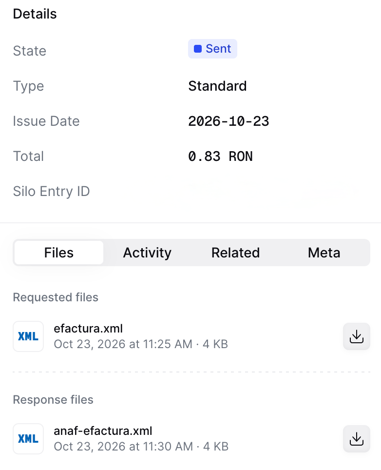

import RomaniaResources from '/snippets/tables/romania-resources.mdx';
import SendWorkflow, { roSendWorkflow } from '/snippets/workflows/ro/send.mdx';
import ExampleAccordion from '/snippets/invoices/ro/accordion.mdx';
import FAQ from '/snippets/faqs/ro/composers/guide-efactura-invoicing.mdx';
import { WorkflowDiagram } from '/snippets/components/workflow.jsx';

## Introduction

[RO e-Factura](https://mfinante.gov.ro/ro/web/efactura) is Romania's mandatory national e-invoicing system, run by the Ministry of Finance and [ANAF](https://www.anaf.ro). Every B2B invoice [in scope](/compliance/romania#what-is-out-of-scope) must be uploaded within 5 working days of issue, and B2C invoices are reported the same way. The platform validates each invoice and seals it with the Ministry of Finance signature: the sealed XML is the legal invoice.

Invoices are encoded in UBL 2.1 following CIUS-RO, the Romanian profile of EN 16931. Invopop builds the XML from your GOBL invoice, checks it against the official ANAF schematron, uploads it and waits for ANAF's decision.

This guide covers three key processes:

- [Invoice issuance](#send-an-invoice): Creating and sending CIUS-RO invoices through RO e-Factura
- [Corrections](#correct-an-invoice): Credit notes and corrective invoices for accepted invoices
- [Special cases](#special-cases): B2C, self-billed and accounting invoices

For registering parties (suppliers) with RO e-Factura, see the companion guide: [Romania: Supplier registration](/guides/ro-efactura-supplier).

Invopop supports two use cases that require different configurations:

- **Send only**: You issue invoices through RO e-Factura on behalf of your suppliers. This is the simplest setup and does not require the Cron app or the sync and import workflows.
- **Send & receive**: In addition to sending, you also want to automatically import invoices received by your suppliers. This requires the Cron app to periodically check for new invoices.

The table below summarizes which components are needed for each use case:

| Component | Send only | Send & receive |
|-----------|:---------:|:--------------:|
| Romania app | ✓ | ✓ |
| Cron app | — | ✓ |
| Generate & send workflow | ✓ | ✓ |
| Import invoice workflow | — | ✓ |
| Sync received invoices workflow | — | ✓ |
| Registration workflow | [Without the subscribe step](/guides/ro-efactura-supplier#setup) | [With the subscribe step](/guides/ro-efactura-supplier#setup) |

| - | Sandbox | Live |
|---|---|---|
| **Supplier** | Registered party with a real CIF | Registered party with a real CIF |
| **Environment** | ANAF test environment, documents have no fiscal value | ANAF production environment |

## Prerequisites

To issue invoices through RO e-Factura, you will need:

- **A registered party (supplier)**: follow the [RO e-Factura supplier registration guide](/guides/ro-efactura-supplier) to connect the Romania app and register the party with ANAF before issuing.
- **Customer details**, including their Romanian CIF for domestic B2B invoices, and their address with county.
- **Line items** with quantities, prices, and applicable VAT rates.

## Setup

All of the following steps must be carried out from the [Invopop Console](https://console.invopop.com).

<Info>
  The Romania app must already be connected and the party registered with ANAF — both are covered in the [supplier registration guide](/guides/ro-efactura-supplier).
</Info>

<Steps>

<Step title="Configure the invoice sending workflow">

This workflow numbers the invoice, converts it to CIUS-RO XML, signs it, sends it to RO e-Factura and renders a PDF:

1. **Set state** to <Badge size="sm" color="yellow" icon="square-small" iconType="solid">Processing</Badge>.
2. **Add sequential code** gives the invoice its number.
3. **Generate e-Factura XML** converts the GOBL invoice to CIUS-RO, checks it against the ANAF schematron and attaches it as `efactura.xml`.
4. **Sign envelope** seals the GOBL document so it can no longer change.
5. **Send invoice to e-Factura** uploads the XML and waits until ANAF accepts or rejects it. On acceptance, the official XML returned by ANAF is attached as `anaf-efactura.xml` and the invoice is stamped with the ANAF upload ID and response date.
6. **Generate PDF** renders a PDF of the invoice in Romanian to hand to your customer.
7. **Set state** to <Badge size="sm" color="blue" icon="square-small" iconType="solid">Sent</Badge>.

<Warning>
  Keep **Sign envelope** before **Send invoice to e-Factura**. Invopop stamps the invoice after sending it, and only a signed invoice can be stamped: the send step fails on an unsigned one.
</Warning>

<Card iconType="duotone" title="e-Factura issue invoice workflow" icon="code-branch" href="https://console.invopop.com/redirect/workflows/new?template=ro-send" horizontal>
  Add to my workspace →
</Card>
<Tabs>
  <Tab title="Workflow">
    <WorkflowDiagram workflow={roSendWorkflow} />
  </Tab>
  <Tab title="Code">
    Copy and paste into a new [Empty Invoice workflow](https://console.invopop.com/redirect/workflows/new?template=empty-invoice) code view.

    <SendWorkflow />
  </Tab>
</Tabs>

Keep the **Workflow ID** at hand, you'll use it later.

</Step>

</Steps>

<Prompt description="Have your agent issue an RO e-Factura invoice in your sandbox." icon="file-invoice" actions={["copy", "cursor"]}>
Read https://docs.invopop.com/guides/ro-efactura.md, https://docs.invopop.com/guides/ro-efactura-supplier.md and https://github.com/invopop/gobl.ro.anaf/blob/main/addon/README.md. In my sandbox workspace, using the token in INVOPOP_TOKEN and the workflow ID I give you, create a bill/invoice entry with $addons containing ro-efactura-v1, the party I registered with ANAF as the supplier, a customer with a Romanian CIF and an address with its county in state, and the lines I describe with taxes as the VAT category plus a rate key. Do not write totals or percentages and do not invent extension codes; start from one of the example invoices in the guide. Run the workflow with wait=30, then fetch the entry and report its state, the stamps in the envelope header, the attached efactura.xml, anaf-efactura.xml and PDF, and any faults with the errors ANAF returned explained using https://docs.invopop.com/faq/romania.md.
</Prompt>

## Running

In this section, we'll provide details on how to issue invoices on behalf of a registered party.

### Send an invoice

Once a party is registered, you can issue invoices on their behalf.

<Tip>
  GOBL invoices sent to RO e-Factura must include the `ro-efactura-v1` addon in `$addons`, which applies the CIUS-RO rules on top of EN 16931.
</Tip>

<Steps>
  <Step title="Upload an invoice">
    Use the [Create an entry](/api-ref/silo/entries/create-an-entry-put) endpoint to upload the invoice details. Include an [invoice](https://docs.gobl.org/draft-0/bill/invoice) object in the [data](/api-ref/silo/entries/create-an-entry-put#body-data) field with these required fields:

    - `$addons`: include [`ro-efactura-v1`](https://github.com/invopop/gobl.ro.anaf/tree/main/addon)
    - `supplier`: use the details of the party you've registered before
    - `customer`: the Romanian CIF for domestic B2B invoices, and the address with its county in `state`

    You can copy one of the example invoices below as a reference. They are partial [GOBL](https://docs.gobl.org) documents you can also paste directly into the [Invopop Console](https://console.invopop.com), then click **Build** and **Save**.

    <ExampleAccordion />

    After uploading you'll see the document in the **Invoices** section with status `Empty`.
  </Step>
  <Step title="Send the invoice to the e-Factura issue invoice workflow">
    Send the invoice to the workflow using the [Create a job](/api-ref/transform/jobs/create-a-job-post) endpoint. Use:

    - `workflow_id`: use the Workflow ID of the **e-Factura issue invoice** workflow we created during setup
    - `silo_entry_id`: use the Silo Entry ID of the invoice you've just uploaded.

    From the Console, open the invoice, click **Select workflow**, choose **e-Factura issue invoice** and click **Run workflow**.

    The job waits on the **Send invoice to e-Factura** step until ANAF decides, which usually takes a few minutes:

    - ✓ **Accepted** (`ok`): the invoice moves to <Badge color="blue">Sent</Badge> and carries the official XML returned by ANAF, next to the generated XML and the PDF. The invoice is stamped with the ANAF upload ID (`ro-anaf-upload-index`) and the date ANAF returned (`ro-anaf-upload-date`), shown in the **Headers** section of the invoice in the Console.
    - × **Rejected** (`nok`): the job fails with the errors ANAF returned. Correct the invoice and run the workflow again.

    <Frame>
      
    </Frame>

    Once ANAF decides, download the official archive it signed with [Fetch sent archive](/api-ref/apps/gov-ro/sent-archive-fetch). It holds the accepted invoice, or the errors of a rejection.
  </Step>
</Steps>

### Issue a credit note

An invoice accepted by RO e-Factura cannot be cancelled. To correct it, issue a new document that references it. In Romania you can either:

- Issue a **credit note** (type code `381`), which adjusts the value of the original invoice, or
- Issue a **corrective invoice** (type code `384`), which replaces the original invoice entirely.

For example, if you issued an invoice for 100 lei but later realized it should have been 80 lei, you can either issue a credit note for 20 lei, or a corrective invoice for 80 lei. Unless you have a specific requirement to replace the original invoice, we recommend only using credit notes. They're more widely supported across countries, while corrective invoices are specific to a few jurisdictions like Romania.

<Steps>
  <Step title="Upload a credit note">
    A credit note in Invopop is an invoice of the type `credit-note`. The process is very similar to uploading an invoice, use the [Create an entry](/api-ref/silo/entries/create-an-entry-put) endpoint to upload a credit note. Include an [invoice](https://docs.gobl.org/draft-0/bill/invoice) object in the [data](/api-ref/silo/entries/create-an-entry-put#body-data) field, with these required fields:

    - `$addons`: include `ro-efactura-v1`
    - `supplier`: use the same supplier details as in the original invoice
    - `type`: `credit-note`
    - `preceding`: references the original invoice, within it, you must include:
      - `uuid`: the UUID of the original invoice (optional but recommended)
      - `issue_date`: the date of the original invoice
      - `series`: the series of the original invoice
      - `code`: the code of the original invoice

    As with every GOBL credit note, quantities and amounts are expressed as positive values. You can copy the **B2B credit note** example above as a reference.

    After successful upload, you'll see the credit note in the **Invoices** section with status `Empty`. If you've included the `uuid` of the invoice in `preceding`, you'll see a link to the credit note in the **Related** tab of the original invoice.
  </Step>
  <Step title="Send the credit note to the e-Factura issue invoice workflow">
    Send the credit note to the same workflow using the [Create a job](/api-ref/transform/jobs/create-a-job-post) endpoint. Use:

    - `workflow_id`: use the Workflow ID of the **e-Factura issue invoice** workflow we created during setup
    - `silo_entry_id`: use the Silo Entry ID of the credit note you've just uploaded.

    The credit note moves to <Badge color="blue">Sent</Badge> once ANAF accepts it.
  </Step>
</Steps>

### Issue a corrective invoice

<Steps>
  <Step title="Upload a corrective invoice">
    A corrective invoice in Invopop is an invoice of the type `corrective`. The process is very similar to uploading an invoice, use the [Create an entry](/api-ref/silo/entries/create-an-entry-put) endpoint to upload a corrective invoice. Include an [invoice](https://docs.gobl.org/draft-0/bill/invoice) object in the [data](/api-ref/silo/entries/create-an-entry-put#body-data) field, with these required fields:

    - `$addons`: include `ro-efactura-v1`
    - `supplier`: use the same supplier details as in the original invoice
    - `type`: `corrective`
    - `preceding`: references the original invoice, within it, you must include:
      - `uuid`: the UUID of the original invoice (optional but recommended)
      - `issue_date`: the date of the original invoice
      - `series`: the series of the original invoice
      - `code`: the code of the original invoice

    The corrective invoice carries the full, corrected content of the original. You can copy the **B2B corrective invoice** example above as a reference.

    After successful upload, you'll see the corrective invoice in the **Invoices** section with status `Empty`. If you've included the `uuid` of the invoice in `preceding`, you'll see a link to the corrective invoice in the **Related** tab of the original invoice.
  </Step>
  <Step title="Send the corrective invoice to the e-Factura issue invoice workflow">
    Send the corrective invoice to the same workflow using the [Create a job](/api-ref/transform/jobs/create-a-job-post) endpoint. Use:

    - `workflow_id`: use the Workflow ID of the **e-Factura issue invoice** workflow we created during setup
    - `silo_entry_id`: use the Silo Entry ID of the corrective invoice you've just uploaded.

    The corrective invoice moves to <Badge color="blue">Sent</Badge> once ANAF accepts it.
  </Step>
</Steps>

### Special cases

Invopop picks the right ANAF upload options from the invoice itself, so the same workflow handles every case:

- **B2C invoices**: when the customer has no tax ID, the invoice is uploaded to ANAF's B2C endpoint. The `ro-efactura-v1` addon adds the thirteen zeros CNP that Romanian law requires for consumers without an identifier.
- **Self-billed invoices** (_autofactură_, type code `389`): add the `self-billed` tag. The customer issues the invoice in the supplier's name, so the **customer** must be the registered party. The addon adds the `Autofactură` note, and the upload is flagged as self-billed.
- **Invoices for accounting purposes** (type code `751`): add the `accounting` tag.
- **Enforcement procedures**: add the `enforcement` tag and name the enforcement body as payee. The upload is made with the payee's CIF and flagged as enforcement.

## GOBL addon reference

Detailed information about the CIUS-RO rules, scenarios and tags can be found in the [`ro-efactura-v1` addon documentation](https://github.com/invopop/gobl.ro.anaf/tree/main/addon).

## FAQ

<FAQ />

More available in our [Romania FAQ](/faq/romania) section

---

<RomaniaResources />

<Card title="Participate in our community"
  icon="forumbee"
  href="https://community.invopop.com"
  arrow="true"
  horizontal
>
  Ask and answer questions about invoicing in Romania →
</Card>
