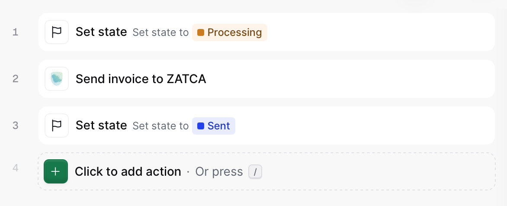

import SaResources from '/snippets/tables/saudi-arabia-resources.mdx';
import SendInvoiceWorkflow, { saSendInvoiceWorkflow } from '/snippets/workflows/sa/send-invoice.mdx';
import SaAccordion from '/snippets/invoices/sa/sa-accordion.mdx';
import FAQ from '/snippets/faqs/sa/composers/guide-zatca-invoicing.mdx';
import { WorkflowDiagram } from '/snippets/components/workflow.jsx';

<Note>
  Make sure you have completed the [registration guide](/guides/sa-zatca-registration) before clearing or reporting invoices.
</Note>

Saudi Arabia runs two e-invoicing flows, and both are driven by the **same GOBL invoice** with the ZATCA add-on. A single send workflow converts the document to UBL 2.1, chains it, signs it, and submits it to the corresponding ZATCA endpoint:

| Flow | Invoices |
|---|---|
| **Clearance** | Standard tax invoices (B2B, B2G) |
| **Reporting** | Simplified tax invoices (B2C) |

## Sending

The send workflow claims the next ICV, builds and hashes the UBL document, signs it and generates the QR (for simplified invoices), submits to ZATCA and then stores the final XML and QR back on the silo entry.

### How it works

<Frame caption="ZATCA send invoice workflow">
  
</Frame>

<Steps>
  <Step title="Set State → Processing">
    Sets the state of the silo entry as "Processing".
  </Step>
  <Step title="Send invoice to ZATCA">
    Converts the GOBL invoice to UBL 2.1, adds the ICV and PIH chain values, hashes the document, and submits it to the clearance or reporting flows. 
  </Step>
  <Step title="Set state → Sent">
    Marks the silo entry as "Sent"
  </Step>
</Steps>

<Card iconType="duotone" title="Saudi Arabia send invoice workflow" icon="code-branch" href="https://console.invopop.com/redirect/workflows/new?template=sa-send-invoice" horizontal>
  Add to my workspace →
</Card>
<Tabs>
  <Tab title="Workflow">
    <WorkflowDiagram workflow={saSendInvoiceWorkflow} />
  </Tab>
  <Tab title="Code">
    Copy and paste into a new [Empty Invoice workflow](https://console.invopop.com/redirect/workflows/new?template=empty-invoice).
    <SendInvoiceWorkflow />
  </Tab>
</Tabs>

<Warning>
  An invoice that already carries the ZATCA QR stamp, `zatca-qr`, is skipped as already sent. The invoice must be signed before this step.
</Warning>

## Credit and debit notes

Issued invoices can't be cancelled or edited once cleared or reported. Corrections are made with **credit notes** (reduction) or **debit notes** (increase) that reference the original invoice. A note flows through the same clearance or reporting model as the document it corrects, using the same send workflow.

## Reading the chain

The ZATCA invoices dashboard lists every invoice the workspace has sent to ZATCA, newest first, so you can follow the cleared and reported chain at a glance. 

Each row surfaces the chain values ZATCA mandates: Supplier Tax Code, Identity Code, Identity Scheme, Invoice Counter, Silo Entry, the document Hash (each invoice's hash seeds the next invoice's PIH, linking the documents into a tamper-evident chain), the Invoice ID, Previous Invoice ID and Created at timestamp. In sandbox, an extra Environment column follows the silo entry, separating Simulation from Developer invoices.

<Note>
  Rows with an empty **Silo Entry** are the compliance sample invoices Invopop submits during [registration](/guides/sa-zatca-registration) to obtain the Production CSID. They advance the chain but do not have a silo entry.
</Note>

<Note>
  The **Supplier Tax Code** in each row is a quick filter: selecting it opens the registrations tab filtered to the party that owns the chain. The **Name** column on that tab filters back the other way, to the party's invoices.
</Note>

## Example invoices

<SaAccordion />

## Errors

**Send invoice to ZATCA** reports a status and a message on the job. The job's `faults` list, returned by [Fetch a job](/api-ref/transform/jobs/fetch-a-job), carries the same message. The messages are listed below exactly as the Saudi Arabia app returns them, so you can match on them. Values in angle brackets vary per invoice. [Step results](/guides/sa-zatca-registration#step-results) explains each status.

| Message | Status | Fix |
|---|---|---|
| `invoice already accepted by ZATCA (zatca-qr stamp present); not sending it again` | `SKIP` | Nothing. ZATCA already accepted this invoice. |
| `invoice must be signed before it can be sent to ZATCA` | `KO` | Sign the entry before the send step. |
| `invoice must carry the sa-zatca-v1 addon to be sent to ZATCA` | `KO` | Add `sa-zatca-v1` to the invoice's `$addons`. |
| `invoice reporter VAT <VAT> has no valid identity (CRN/MOM/MLS/700/SAG/OTH); cannot route to a registration` | `KO` | Give the supplier the identity it was [registered](/guides/sa-zatca-registration#multi-branch-entities) with. On a self-billed invoice, the customer is the reporter. |
| `party with VAT <VAT> and identity <type>:<code> is not registered for this owner; complete onboarding before sending invoices` | `KO` | [Register](/guides/sa-zatca-registration) a party with this VAT number and identity in the workspace, or fix the invoice to match an existing registration. |
| `party has not completed onboarding process` | `KO` | Wait until the [registration workflow](/guides/sa-zatca-registration#how-it-works) completes and the party entry is `registered`. |
| `cannot build the ZATCA QR code (<reason>)` | `KO` | The reason names the problem, for example a QR code over ZATCA's length limit and its largest field. Shorten that field on the invoice. |
| `ZATCA schematron validation failed:` followed by one line per failed rule | `KO` | Invopop checks the final XML against ZATCA's schematron before sending. Fix the invoice for each listed rule. |
| `ZATCA rejected the invoice (validation: <ZATCA status>: <ZATCA message>)` | `KO` | ZATCA returned `NOT_CLEARED` or `NOT_REPORTED`. The message is the first error ZATCA listed. |

ZATCA's own messages come from its business rules, so this page can't list them. They reach you through the last two messages above. GOBL catches most of these problems when it builds the invoice, with the `sa-zatca-v1` addon. Its rules and their BR-KSA references are in the [addon's validation rules](https://docs.gobl.org/addons/sa-zatca-v1#validation-rules).

## FAQ

<FAQ />

More available in our [Saudi Arabia FAQ](/faq/saudi-arabia) section.

---

<SaResources />

<Card title="Participate in our community"
  icon="forumbee"
  href="https://community.invopop.com"
  arrow="true"
  horizontal
>
  Ask and answer questions about invoicing in Saudi Arabia →
</Card>
