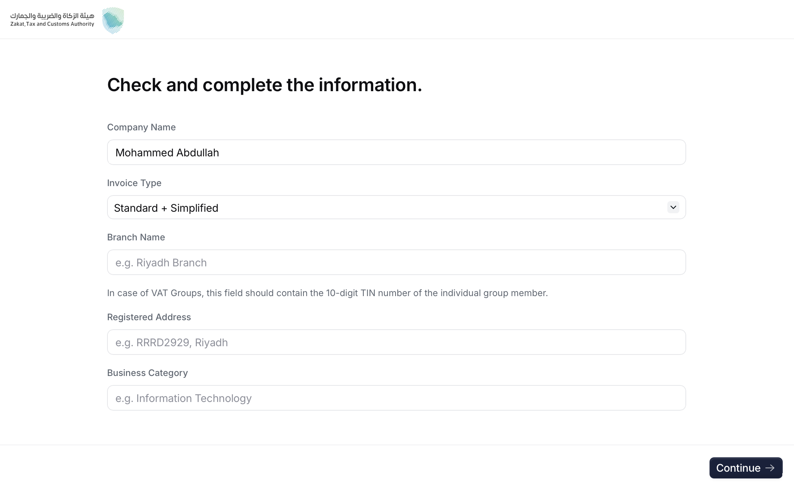
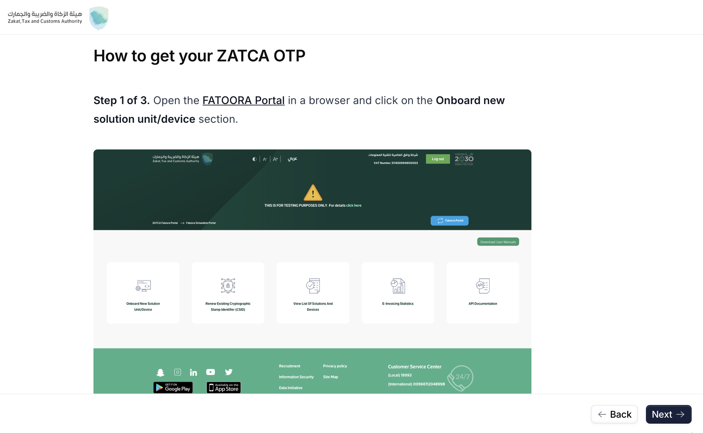
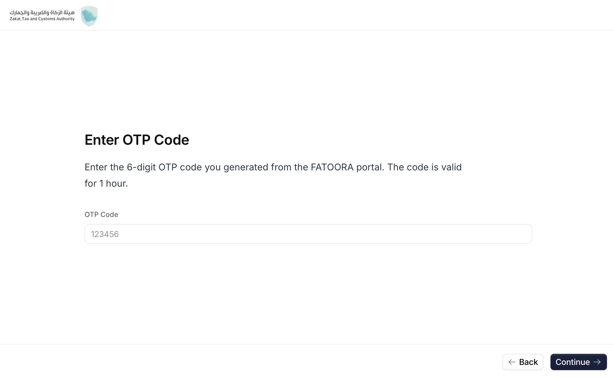
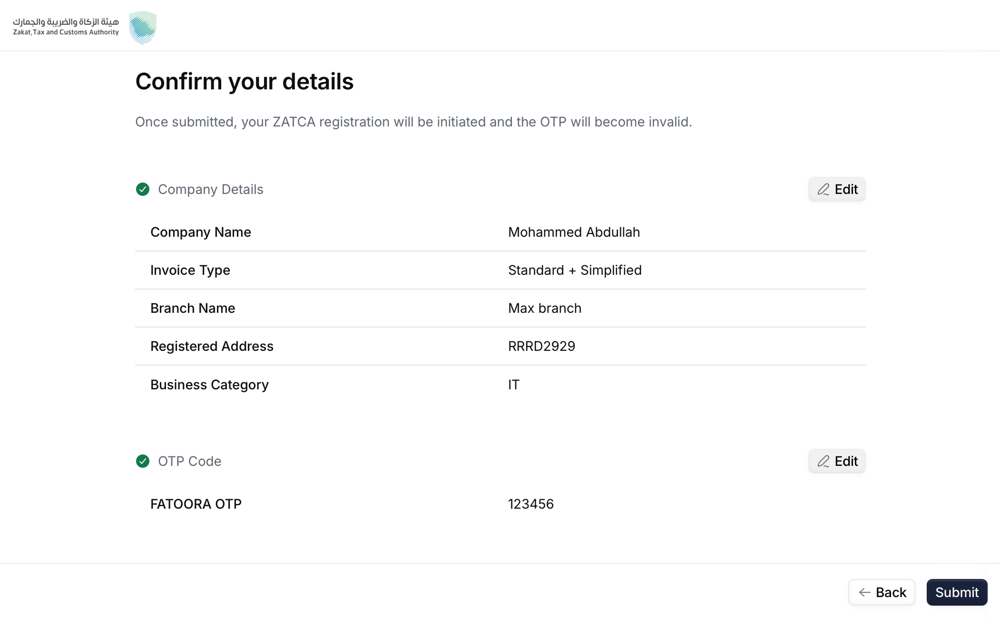
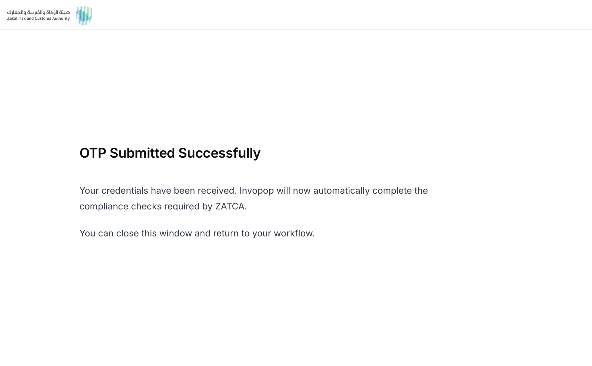

import SaResources from '/snippets/tables/saudi-arabia-resources.mdx';
import RegisterWorkflow, { saRegisterWorkflow } from '/snippets/workflows/sa/register.mdx';
import UnregisterWorkflow, { saUnregisterWorkflow } from '/snippets/workflows/sa/unregister.mdx';
import FAQ from '/snippets/faqs/sa/composers/guide-zatca-supplier.mdx';
import { WorkflowDiagram } from '/snippets/components/workflow.jsx';

<Note>
  Registration is required for any Saudi VAT number that will clear or report invoices through Invopop. It is a prerequisite for the [clearance and reporting](/guides/sa-zatca-clearance-reporting) flow.
</Note>

## Sandbox environments

In sandbox, the **Register Party** step's configuration selects which ZATCA portal to onboard against. Production enrollments ignore this and always use the live endpoint.

| Mode | Target | OTP in the wizard | Use it to |
|---|---|---|---|
| `developer` | ZATCA Developer (sandbox) portal | **Dummy** — any placeholder value is accepted | Test the onboarding flow end to end without touching a real ZATCA account. |
| `simulation` (default) | ZATCA Simulation portal | **Real** — must be generated from the supplier's FATOORA Simulation account | Rehearse the production onboarding with genuine certificates and compliance checks before going live. |

The two modes target different ZATCA sandbox endpoints and differ mainly in how the OTP is treated:

- **Developer** is the lightweight sandbox. ZATCA does not validate the OTP, so the value the supplier types in the [onboarding wizard](#the-onboarding-wizard) is a dummy.

  You can **register any party** in developer mode, but ZATCA only accepts **invoices issued from its fixed test VAT number, `399999999900003`**.
- **Simulation** mirrors production. The OTP must be a **real** one-time password the supplier generates from their FATOORA *Simulation* portal, exactly as they would in production.

<Note>
  In both sandbox modes the supplier still completes the same wizard, only the OTP requirement changes.
</Note>

## How it works

Registration spans two parts: a workflow you run against the party document, and a hosted onboarding wizard the supplier completes to provide the FATOORA OTP.

<Steps>
  <Step title="Set State → Processing">
    Sets the state of the silo entry as "Processing".
  </Step>
  <Step title="Register supplier with ZATCA">
    Validates the party's name, tax ID, [supplier identity](#multi-branch-entities), and full address, stakes the claim on that VAT number and identity, then publishes a public onboarding link in the meta section of the party. The supplier follows this link to complete the onboarding wizard.

    The company name and registered address are recorded on the registration at this point, so correcting either one on the party means re-running this step before the supplier submits the OTP.

    Both values go into the certificate signing request, or CSR, that Invopop sends to ZATCA. ZATCA limits each CSR field to 64 characters, the X.509 upper bound. Arabic and Latin letters, spaces and punctuation all count.

    - **Company name:** the party `name`.
    - **Registered address:** built from the party's first address. Its `street`, `num`, `region` and `country` are joined in that order, separated by a comma and a space. Empty fields are skipped, and `country` defaults to `SA`.

    This step checks both lengths before it publishes the onboarding link, so a value that is too long fails here, before the supplier spends an OTP. The limit applies to the registration only. Invoices take the supplier name and address from the invoice document, so they keep the full values. See [the registered address limit](#the-registered-address-limit) for fixes.
  </Step>
  <Step title="Wait for ZATCA certificate upload">
    Pauses until the supplier uploads the compliance CSID. It will then submit the mandatory compliance sample invoices and swaps the Compliance CSID with the Production CSID.
  </Step>
  <Step title="Set State → Registered">
    Sets the state of the silo entry as "Registered".
  </Step>
</Steps>

<Card iconType="duotone" title="ZATCA register party workflow" icon="code-branch" href="https://console.invopop.com/redirect/workflows/new?template=sa-register" horizontal>
  Add to my workspace →
</Card>
<Tabs>
  <Tab title="Workflow">
    <WorkflowDiagram workflow={saRegisterWorkflow} />
  </Tab>
  <Tab title="Code">
    Copy and paste into a new [Empty Party workflow](https://console.invopop.com/redirect/workflows/new?template=empty-party).
    <RegisterWorkflow />
  </Tab>
</Tabs>

## The onboarding wizard

The link published by **Register Party** provides an onboarding wizard for the supplier to complete:

<Steps>
  <Step title="Company details">
    <Frame caption="Company details screen">
      
    </Frame>
    The supplier provides the **invoice type** (`1000` standard, `0100` simplified, or `1100` both), **branch name**, and **business category**. These values feed the certificate request, together with the company name and the registered address taken from the party document.

    Branch name and business category are each limited to 64 characters, like the company name. When the supplier's VAT number belongs to a VAT group, with `1` as its 11th digit, the wizard asks for the **Group Member TIN** in place of the branch name. It must be the 10-digit TIN of the group member being registered.
  </Step>
  <Step title="Get the OTP from FATOORA">
    <Frame caption="FATOORA instructions screen">
      
    </Frame>
    The supplier signs in to the FATOORA portal and generates a One-Time Password for the EGS unit. The wizard shows the relevant FATOORA screens.
  </Step>
  <Step title="Enter the OTP">
    <Frame caption="OTP Code screen">
      
    </Frame>
    The supplier pastes the OTP and reviews the recap of the details that will be sent to ZATCA.
  </Step>
  <Step title="Confirm details">
    <Frame caption="Confirmation screen">
      
    </Frame>
    Here you will make sure all the details you entered were correct. Click "Back" if you need to change anything.
  </Step>
  <Step title="Submit">
    <Frame caption="Submission screen">
      
    </Frame>
    Upon submit, Invopop requests the **Compliance CSID**, and stores the credentials. This unblocks the **Wait for ZATCA certificate upload** step in the workflow.
  </Step>
</Steps>

<Info>
  The invoice type chosen here determines which compliance samples Invopop submits: `1000` runs standard tax invoices, credit notes, and debit notes; `0100` runs the simplified equivalents; `1100` runs both sets.
</Info>

## Reading registrations

The ZATCA registrations dashboard lists every party the workspace has onboarded, ordered alphabetically by name, so you can confirm what a supplier is registered for without leaving the console.

Each row carries the registration's details: Name, Branch Name, Identity Code, Identity Scheme, Business Category, Registered Address, Tax Code, Simplified Invoices and Standard Invoices, showing which document types the party can submit, Status — *Registered*, or *Unregistered* and the Silo Entry the registration was started from. In sandbox, an extra Environment column precedes the tax code, separating Simulation from Developer registrations.

<Note>
  The **Name** in each row is a quick filter: selecting it opens the invoices tab filtered to that party's [cleared and reported chain](/guides/sa-zatca-clearance-reporting). The **Supplier Tax Code** column on that tab filters back the other way, to the registered party.
</Note>

## Unregistration (sandbox only)

Unregistering a party from ZATCA in production environment is handled by the **taxpayers**, directly in the **FATOORA portal**, signing in with their own credentials.

Invopop also provides an unregister action that removes the party and its stored credentials from **Invopop's internal systems only**. It does not touch the party's registration with ZATCA. It targets a single registration, the one that matches the party's VAT number and [supplier identity](#multi-branch-entities), so unregistering one branch leaves the other registrations under the same VAT number untouched.

<Warning>
  This action is intended for **testing in sandbox** — for example, to re-onboard the same VAT number and identity during development. It is **not** for live environments; unregistering at ZATCA is always done by the taxpayer in the FATOORA portal.
</Warning>

<Card iconType="duotone" title="ZATCA unregister supplier workflow (sandbox only)" icon="code-branch" href="https://console.invopop.com/redirect/workflows/new?template=sa-unregister" horizontal>
  Add to my workspace →
</Card>
<Tabs>
  <Tab title="Workflow">
    <WorkflowDiagram workflow={saUnregisterWorkflow} />
  </Tab>
  <Tab title="Code">
    Copy and paste into a new [Empty Party workflow](https://console.invopop.com/redirect/workflows/new?template=empty-party).
    <UnregisterWorkflow />
  </Tab>
</Tabs>

## Multi-branch entities

A business can run several branches that all share the same VAT number while each branch onboards its own device or system. A single VAT number therefore often needs more than one registration, and Invopop supports this through the [GOBL identities](https://docs.gobl.org/draft-0/org/identity) field.

Every party registered with ZATCA is linked to a unique CSID certificate that identifies both its VAT number and its branch. Invopop gives each unique combination of VAT number and supplier identity its own CSID certificate, allowing them to act independently and through their own invoice chain.

Set the identity on the [`org.Party`](https://docs.gobl.org/draft-0/org/party) document as an entry in `identities` whose `type` is one of:

| `type` | Identity |
|---|---|
| `CRN` | Commercial Registration Number |
| `MOM` | Momrah license (Ministry of Municipality, Rural Affairs and Housing) |
| `MLS` | MLSD license (Ministry of Human Resources and Social Development) |
| `700` | 700 number (unified national number) |
| `SAG` | Sagia license (Ministry of Investment, formerly SAGIA) |
| `OTH` | Other identifier |

## Errors

Each step of the registration workflow reports a status and a message on the job. The job's `faults` list, returned by [Fetch a job](/api-ref/transform/jobs/fetch-a-job), carries the same messages. They are listed below exactly as the Saudi Arabia app returns them, so you can match on them. Values in angle brackets vary per document. Errors from sending invoices are in [clearance and reporting](/guides/sa-zatca-clearance-reporting#errors).

### Step results

| Status | Meaning | What to do |
|---|---|---|
| `KO` | The data is invalid, or the registration is missing or incomplete. The job stops and runs its error steps. | Fix the cause and run the workflow again. |
| `QUEUED` | The step waits for the supplier or for ZATCA, then checks again later. | Nothing. The step completes once the supplier or ZATCA finishes. |
| `SKIP` | The work was already done. The workflow continues. | Nothing. |
| `ERR` | An internal or connection problem, or a ZATCA server error. Invopop retries the step. | Nothing. Contact support if it keeps failing. |

### Registration errors

**Register supplier with ZATCA** checks the party and stops at the first problem it finds. Fix it and run the workflow again to see the next one.

| Message | Status | Fix |
|---|---|---|
| `only org/party documents are supported` | `KO` | Run the registration workflow on an `org/party` entry. |
| `party name is required` | `KO` | Set the party `name`. |
| `party tax ID is required` | `KO` | Set `tax_id.code` to the Saudi VAT number. |
| `party must have exactly one identity of type CRN, MOM, MLS, 700, SAG, or OTH` | `KO` | Keep exactly one entry in `identities`. See [multi-branch entities](#multi-branch-entities). |
| `party identity must be one of CRN, MOM, MLS, 700, SAG, or OTH with a non-empty code` | `KO` | Use one of the listed `type` values and set its `code`. |
| `party name must be at most 64 characters.` | `KO` | Shorten the name. Bilingual legal names often go over: keep one language only. |
| `party street, num, region and country must together be at most 64 characters.` | `KO` | See [the registered address limit](#the-registered-address-limit). |
| `party must have an address with num, code, locality, street_extra, street, and country` | `KO` | Fill in these fields on one address. `region` is optional. |
| `party already registered in silo entry <silo entry ID>` | `KO` | Another entry holds this VAT number and identity. Run the workflow on that entry. In sandbox, you can unregister it first. |
| `registration link already exists` | `SKIP` | The onboarding link is already on the entry's meta. Share that link with the supplier. |

**Wait for ZATCA certificate upload** reports the progress of the wizard and of the compliance tests.

| Message | Status | Fix |
|---|---|---|
| `waiting for OTP submission` | `QUEUED` | The supplier has not submitted the OTP yet. Share the onboarding link. |
| `waiting for ZATCA compliance tests` | `QUEUED` | Invopop is submitting the compliance samples. Nothing to do. |
| `no registration for this silo entry, run gov-sa.register first` | `KO` | Add **Register supplier with ZATCA** before this step, on the same entry. |
| `Failed to submit <sample> compliance test to ZATCA. <ZATCA message>` | `KO` | ZATCA rejected a compliance sample. The step's code names the sample. |
| `Failed to complete ZATCA compliance tests. <ZATCA message>` | `KO` | The compliance tests failed outside a sample, for example when the production CSID was requested. |
| `ZATCA compliance tests did not complete.` | `KO` | The compliance tests stopped without a ZATCA message. |

After a compliance failure, Invopop discards the compliance CSID. Fix the party if the ZATCA message points to its data. Then run the registration workflow again, and the supplier submits a new OTP through the same link.

### Wizard errors

The wizard shows these messages on the form. The supplier corrects the field and continues. The job is not affected.

- `invoice type must be Standard (1000), Simplified (0100), or Both (1100)`
- `branch name is required`
- `branch name must be at most 64 characters`
- `VAT group member TIN must be 10 digits`
- `business category is required`
- `business category must be at most 64 characters`
- `OTP is required`
- `OTP must be 6 digits`

### The registered address limit

The registered address joins the `street`, `num`, `region` and `country` of the party's first address. This address:

```json
{
  "num": "1234",
  "street": "King Fahd Road",
  "street_extra": "Al Olaya",
  "locality": "Riyadh",
  "region": "Riyadh Province",
  "code": "12211",
  "country": "SA"
}
```

gives `King Fahd Road, 1234, Riyadh Province, SA`, 41 characters. When the result is over 64 characters, you have two fixes:

- **Shorten the street:** use a shorter form of the street name in `street`.
- **Leave the region empty:** `region` is optional at registration.

ZATCA describes this CSR field as the location of the branch or EGS unit, preferably in the short address format of the Saudi National Address. Source: [E-invoicing Detailed Technical Guidelines](https://zatca.gov.sa/en/E-Invoicing/Introduction/Guidelines/Documents/E-invoicing-Detailed-Technical-Guideline.pdf), page 28, CSR inputs table.

The limit is ZATCA's. ZATCA rejects a longer value after the OTP is spent, so Invopop checks it first. Shortening the address changes the registration only. Invoices keep the full address from the invoice document.

## FAQ

<FAQ />

More available in our [Saudi Arabia FAQ](/faq/saudi-arabia) section.

---

<SaResources />

<Card title="Participate in our community"
  icon="forumbee"
  href="https://community.invopop.com"
  arrow="true"
  horizontal
>
  Ask and answer questions about invoicing in Saudi Arabia →
</Card>
