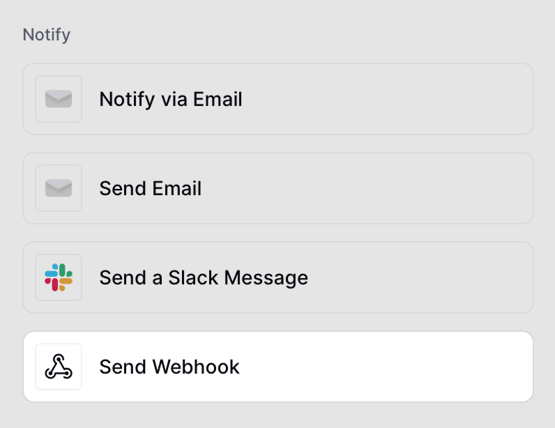
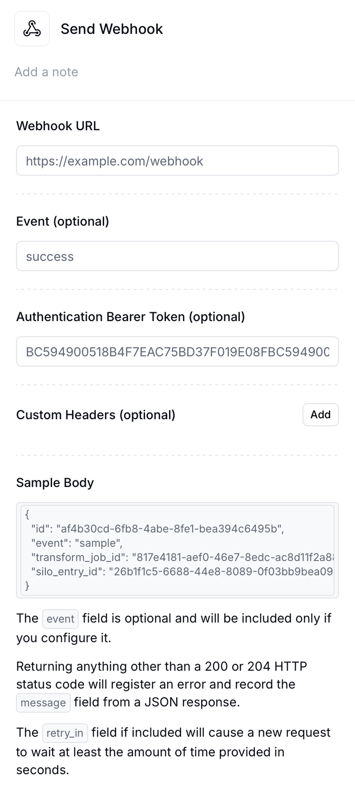

## Introduction

This guide will show you how to configure the **Send Webhook** workflow step to send HTTP requests automatically from your workflows. You can use webhooks to notify external systems, trigger automations, or synchronize data with third-party APIs whenever an event occurs.

## Setup and configuration

Add the **Send Webhook** step to your workflow by searching or locating it in the actions list under the **Notify** section.

<Frame>
  
</Frame>

Then configure your Webhook:

<Frame>
  
</Frame>

**Webhook URL**<br />
The endpoint that will receive the `POST` request.

**Event (optional)**<br />
Specify a custom event name such as `success`, `error`, or `invoice_sent`. This will appear under the `event` field in the JSON payload.

**Authentication**<br />
Choose how the request authenticates with your endpoint. Only the selected type is saved.

- **None**: requests are sent without credentials.
- **Bearer token**: a static token. Each request carries the header `Authorization: Bearer <your_token>`.
- **OAuth 2.0**: Invopop requests a short-lived token from your authorization server with the client credentials grant. Each request carries the header `Authorization: Bearer <access_token>`.

Invopop does not recommend whitelisting IPs for security as the static IP is likely to change in the future.

**OAuth 2.0 client credentials**<br />
Use OAuth 2.0 when your endpoint or API gateway only accepts short-lived tokens. Fill in these fields:

- **Token URL**: the token endpoint of your authorization server. It must use HTTPS.
- **Client ID**: the client identifier issued by your authorization server.
- **Client secret**: the secret for that client. It is not shown again after saving. Leave the field empty to keep the saved secret, or type a new one to replace it.
- **Scope (optional)**: the scopes to request, separated by spaces. Leave it empty if your server needs none.

How Invopop gets and refreshes the token:

- It calls the token URL with `grant_type=client_credentials`. The client ID and secret go in the HTTP Basic header first. If the server answers `400` or `401`, Invopop tries once with the credentials in the form body, then keeps the style that worked.
- It reuses the token until 30 seconds before `expires_in`. For tokens that last less than a minute, it refreshes at half the lifetime.
- If your endpoint answers `401`, Invopop drops the token and the attempt fails. The next [retry](#retries) requests a new token. There is no retry inside the same attempt.

<Note>Each Invopop server keeps its own token. Several valid tokens can exist at the same time for one webhook configuration. Your authorization server must allow several active tokens per client.</Note>

<Warning>Never expose sensitive credentials directly in the webhook URL. Always use a bearer token, OAuth 2.0 or custom headers for secure authentication.</Warning>

**Custom Headers (optional)**<br />
Add one or more HTTP headers. This is useful for services that require API keys, content types, or verification signatures.

**Sample Body**<br />
Below is an example of the JSON payload that will be sent:

```json
{
  "id": "",
  "event": "",
  "transform_job_id": "",
  "silo_entry_id": "",
  "owner_id": "",
  "key": "",
  "args": {},
  "faults": []
}
```

- `id` the id of the webhook event.
- `event` custom event name set up in the step (if any).
- `transform_job_id`  the id of a job run through the [Transform Job endpoint](/api-ref/transform/jobs/fetch-a-job-by-key)
- `silo_entry_id` the id of the [silo entry](/api-ref/silo/entries/fetch-an-entry)
- `key` the job's [key](/api-ref/transform/jobs/create-a-job-put#body-key) to ensure [idempotency](/api-ref/idempotency).
- `args` certain workflow steps can add data to the args field which is then made available to subsequent steps and to webhook payloads.
- `faults` array of [fault](/api-ref/transform/jobs/fetch-a-job#response-faults) objects that represent errors that occurred during the processing of the job.

<Info>
These are the faults of the job identified by `transform_job_id`, and together with the same array on the [job itself](/api-ref/transform/jobs/fetch-a-job) they are the reliable record of what went wrong. Prefer them over the `faults` field on the [silo entry](/api-ref/silo/entries/fetch-an-entry), which exists for backwards compatibility and is only populated when the entry's last state came from a job that errored or failed.
</Info>

<Info> The webhook will expect a `200` or `204` response code. Any other response will be treated as an error and will be automatically retried after a delay. </Info>

<Prompt description="Have your agent build a webhook receiver for job results." icon="webhook" actions={["copy", "cursor"]}>
Read https://docs.invopop.com/guides/webhooks.md and https://docs.invopop.com/llms.md. Implement an HTTPS endpoint in this project that receives Invopop's Send Webhook POST requests. Verify the bearer token, the OAuth 2.0 bearer token or the custom header I configure in the workflow step. Parse the JSON body fields id, event, transform_job_id, silo_entry_id, key, args and faults, and treat deliveries as idempotent using id and key. Respond 200 quickly and process asynchronously. On success events fetch the silo entry from the Invopop API and store its state and attachment URLs. On error events store the faults from the payload and fetch the job for the per-step trace. Return a non-200 status only when Invopop should retry, and document the retry schedule from the guide in a code comment.
</Prompt>

## Retries

When a webhook is triggered, Invopop will wait for a response. The behavior is as follows:

* Success (`200`/`204`) → Webhook will produce an `OK` status and no retry process will be triggered.
* Anything else → Webhook will trigger the retry process.

Retries happen automatically using exponential backoff for error messages in jobs:
5s → 10s → 20s → 40s → 80s → … doubling up to 1,280s. Subsequently, the system will wait 30 minutes between retries until a maximum of 12 hours is reached.

If you wish to change this behavior, include a `retry_in` field in your response with the number of seconds you wish to wait between retries. The system will then retry up to 32 times before returning a `KO` status. Here is an example of such a response:

```
{
  "code":"503",
  "message":"Service Unavailable",
  "retry_in": 20
}
```

## FAQ
<AccordionGroup>
    <Accordion title="What happens if my webhook endpoint is down?">
        If your endpoint fails to respond or returns a non-`200`/`204` status code, Invopop will retry automatically. If the
        error persists, the webhook step will return a `KO` status.
    </Accordion>
    <Accordion title="Can I send multiple webhooks in the same workflow?">
        Yes. You can add multiple **Send Webhook** actions in the same workflow, each targeting a different endpoint or event.
    </Accordion>
    <Accordion title="What security options are available?">
        You can authenticate using a static bearer token, OAuth 2.0 client credentials or custom headers (e.g. `X-Signature`, `X-API-Key`). See [Setup and configuration](#setup-and-configuration) for the OAuth 2.0 fields. It’s recommended to use HTTPS and verify the token or header server-side.
    </Accordion>
    <Accordion title="What content type do webhooks use?">
        All webhook requests are sent with `Content-Type: application/json`.
    </Accordion>
    <Accordion title="Can I customize the json payload of the webhook?">
    You can’t customize the webhook payload. If you need additional information, fetch the corresponding entry or job directly. This design ensures security compliance by preventing sensitive data from being delivered through webhooks.
    </Accordion>
</AccordionGroup>

<Card title="Participate in our community"
  icon="forumbee"
  href="https://community.invopop.com"
  arrow="true"
  horizontal
>
  Ask and answer questions about webhooks →
</Card>
